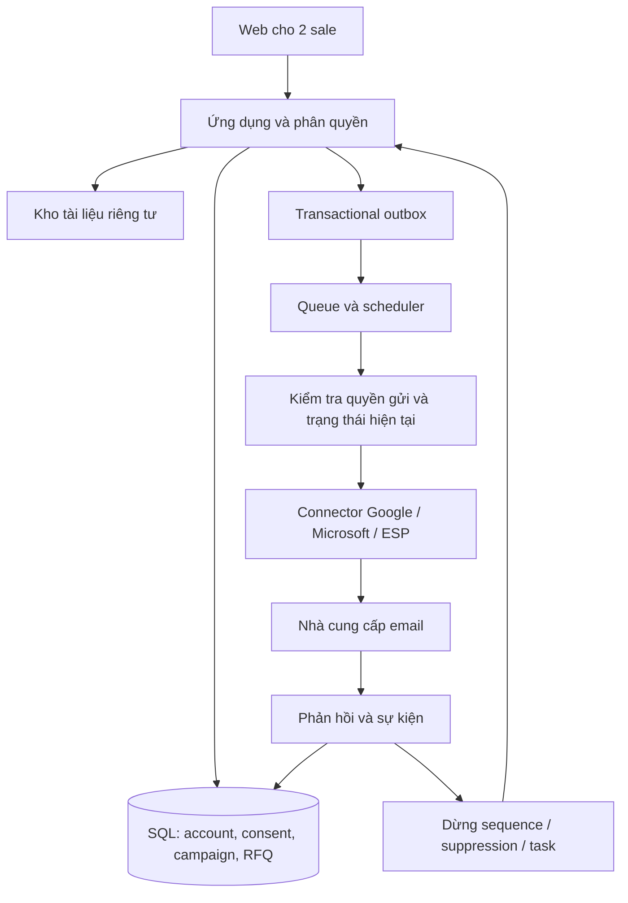

# Kế hoạch tool email cho sale DMC/tour operator

Ngày nghiên cứu: 02/11/2026. Trạng thái: đề xuất sản phẩm và kỹ thuật, chưa triển khai phần mềm, chưa gửi email.

## 1. Bối cảnh đã xác nhận

- Doanh nghiệp DMC/tour operator bán tour và dịch vụ cho đại lý/công ty lữ hành.
- Hiện có 2 sale, dùng email Google và Outlook. Chưa xác định tài khoản cá nhân hay Google Workspace/Microsoft 365.
- Data hiện tại đều là khách mới chưa từng liên hệ, chủ yếu ở Việt Nam; nước ngoài chiếm ít.
- Nguồn data: website và dữ liệu công ty cung cấp. Chưa có bằng chứng xác nhận đồng ý nhận quảng cáo trong thông tin được cung cấp.
- Chưa xác định số lượng liên hệ, ngân sách, CRM hiện có và mức độ chuẩn hóa bảng giá.

### Quyết định đề xuất

Xây công cụ quản lý tiếp cận và chăm sóc đại lý, có chức năng gửi chiến dịch cho liên hệ đủ điều kiện. Hai luồng riêng: nghiên cứu đại lý mới và chăm sóc đối tác được phép nhận thư. Dữ liệu website/công ty cung cấp không tự động được gán quyền gửi.

MVP phục vụ 2 người, ưu tiên giảm thao tác, tránh bỏ sót phản hồi, giữ đúng bảng giá và lịch sử làm việc. Chưa cần kiến trúc microservices, hệ thống tìm lead tự động quy mô lớn, hay tự vận hành mail server.

## 2. Research và tác động lên sản phẩm

### 2.1 Điều kiện gửi và xử lý dữ liệu

Ở Việt Nam, Nghị định 91/2020 đặt ra sự đồng ý trước, cơ chế từ chối và giới hạn tần suất email quảng cáo. Vì vậy hệ thống cần bằng chứng quyền gửi và danh sách chặn dùng chung. [Nguồn Chính phủ](https://vanban.chinhphu.vn/?docid=200773&pageid=27160), [hướng dẫn của cơ quan nhà nước](https://skhcn.angiang.gov.vn/giang-tuyen-truyen-pho-bien-nghi-dinh-cua-chinh-phu-quy-dinh-ve-chong-tin-nhan-rac-thu-dien-tu-rac).

Khung dữ liệu cá nhân cần đối chiếu gồm Luật 91/2025/QH15, Nghị định 356/2025 và quy định xử phạt cập nhật năm 2026. Đưa vào backlog: nguồn dữ liệu, mục đích xử lý, bằng chứng đồng ý, quyền truy cập/xóa và đánh giá bên xử lý. [Luật](https://bocongan.gov.vn/bai-viet/luat-bao-ve-du-lieu-ca-nhan-chinh-thuc-co-hieu-luc-thi-hanh-tu-ngay-01-01-2026-1767186124), [Nghị định 356](https://congbao.cdnchinhphu.vn/180507251028987904/2026/1/17/356signed-1768638052103952849513.pdf), [Nghị định 330](https://xaydungchinhsach.chinhphu.vn/nghi-dinh-330-2026-nd-cp-ve-xu-phat-vi-pham-hanh-chinh-trong-linh-vuc-an-ninh-mang-119260824172446407.htm).

Quy tắc triển khai phải phân biệt thông tin doanh nghiệp và thông tin cá nhân. Không có bằng chứng đồng ý không có nghĩa mọi xử lý dữ liệu đều bị cấm; nhưng liên hệ chưa qua đánh giá không được tự động đưa vào chiến dịch quảng cáo. Phạm vi nghĩa vụ cụ thể, thời hạn lưu và chuyển dữ liệu ra nước ngoài được rà soát theo cách vận hành thực tế trước khi bật gửi.

### 2.2 Nhà cung cấp email

Amazon SES yêu cầu cam kết chỉ gửi cho người đã yêu cầu nhận thư khi xin production access; Brevo cũng yêu cầu consent. Đây không phải lựa chọn để nạp ngay danh sách chưa từng liên hệ. [SES](https://docs.aws.amazon.com/ses/latest/dg/request-production-access.html), [Brevo](https://help.brevo.com/hc/en-us/articles/209405205-What-is-the-anti-spam-policy-of-Brevo).

Google có yêu cầu xác thực và hủy đăng ký đối với bulk sender. Thiết kế chuẩn xác thực ngay từ đầu dù quy mô hiện tại nhỏ. Subdomain giúp tổ chức luồng gửi nhưng không bảo đảm cách ly hoàn toàn uy tín tên miền. [Google](https://support.google.com/mail/answer/81126?hl=en), [FAQ](https://support.google.com/mail/answer/14229414?hl=en).

Microsoft có hạn mức cho Exchange Online và khuyến nghị giải pháp riêng cho bulk email. Không lấy hạn mức kỹ thuật làm mục tiêu gửi của sale. Outlook.com cũng có yêu cầu xác thực cho bên gửi lớn. [Exchange Online](https://learn.microsoft.com/en-us/office365/servicedescriptions/exchange-online-service-description/exchange-online-limits), [Outlook.com](https://support.microsoft.com/en-gb/outlook/fix-ndr-error-550-5-7-515-in-outlook-com).

### 2.3 Workflow và đặc thù du lịch

HubSpot có cơ chế dừng sequence khi khách trả lời/đặt lịch; Brevo hỗ trợ segment động. Đây là các khả năng nền tảng cần tham khảo. [HubSpot](https://knowledge.hubspot.com/sequences/unenroll-from-sequence), [Brevo](https://help.brevo.com/hc/en-us/articles/4411804163090-Overview-of-the-Segments-page).

Hotelbeds phân biệt thông tin sản phẩm, giá/tình trạng khả dụng và bước kiểm tra lại một số loại giá. Suy ra: email phải có phiên bản và hạn hiệu lực; bảng giá đã gửi không đồng nghĩa còn chỗ hoặc đã giữ dịch vụ. [Tài liệu Hotelbeds](https://developer.hotelbeds.com/documentation/hotels/booking-api/).

Apple Mail Privacy Protection làm tín hiệu mở thư không đáng tin để kết luận khách quan tâm. Đo phản hồi, yêu cầu báo giá và lợi nhuận thực tế. [Apple](https://www.apple.com/legal/privacy/data/en/mail-privacy-protection/).

Các mục sau là đề xuất thiết kế phù hợp doanh nghiệp này, không phải benchmark thị trường hay cam kết inbox/doanh thu.

## 3. Mục tiêu kinh doanh và phạm vi

### Mục tiêu

1. Mỗi đại lý có một người phụ trách và một lịch sử tương tác thống nhất.
2. Sale biết hôm nay cần nghiên cứu ai, trả lời ai, follow-up báo giá nào.
3. Gửi đúng sản phẩm, đúng ngôn ngữ, đúng nhóm giá, đúng người và đúng quyền gửi.
4. Đo được từ tiếp cận đến phản hồi, RFQ, báo giá, booking và lợi nhuận gộp.

### Nhóm đối tác

- Đại lý bán tour ghép, công ty lữ hành tổ chức đoàn, đơn vị outbound/inbound, đơn vị chuyên MICE.
- Phân khúc theo thị trường khách, khu vực hoạt động, điểm đến bán, dòng tour, quy mô đoàn, ngôn ngữ, cấp đại lý.
- Account là công ty; contact là người hoặc hộp thư thuộc công ty. Không đồng nhất hai đối tượng này.
- Một đại lý có thể vừa cung cấp dịch vụ vừa mua dịch vụ; lưu vai trò thay vì tạo hai bản ghi trùng.

### Chưa làm trong MVP

- CRM toàn diện thay hệ thống hiện tại; booking engine; kế toán/công nợ đầy đủ.
- Kết nối tồn chỗ trực tiếp với nhà cung cấp; tích hợp hàng loạt CRM.
- Tự động thu thập hàng loạt email; mua data; nuôi tương tác giả; xoay tài khoản để vượt giới hạn.
- AI tự đặt giá, tự xác nhận chỗ, tự gửi báo giá hoặc tự đăng ký lead vào chiến dịch.
- Nền tảng SaaS nhiều doanh nghiệp, billing, SSO doanh nghiệp và dedicated IP.

## 4. Vai trò và quyền

| Vai trò | Quyền chính |
|---|---|
| Sale A/B | Quản lý đại lý được giao, soạn thư, tạo task/RFQ/báo giá, xem lịch sử trong phạm vi được cấp |
| Quản lý kiêm admin | Phân lead, duyệt campaign, cấu hình bảng giá, duyệt ngoại lệ, quản lý người dùng |
| Vận hành kỹ thuật | Cấu hình kết nối, giám sát lỗi; quyền đọc dữ liệu kinh doanh tối thiểu |

Với 2 sale, một người có thể kiêm quản lý. Campaign đầu tiên hoặc thay đổi bảng giá quan trọng cần kiểm tra bởi người còn lại. Duyệt nội bộ không thay thế căn cứ được phép gửi.

## 5. Backlog theo mức ưu tiên

P0: cần cho bản đầu. P1: thêm sau pilot. P2: khi có nhu cầu và dữ liệu chứng minh.

| ID | Chức năng | Mức | Quy tắc chính |
|---|---|---|---|
| DATA-01 | Import CSV/XLSX, ánh xạ cột, xem trước | P0 | Hiện số hợp lệ/trùng/thiếu nguồn; lưu batch; không tự gửi sau import |
| DATA-02 | Account/contact, owner, timeline | P0 | Một owner chính/account; trùng email xử lý riêng với trùng công ty |
| DATA-03 | Nguồn và quyền dùng dữ liệu | P0 | Source URL/tệp gốc, ngày thu thập, mục đích, căn cứ xử lý/quyền gửi, chứng cứ, người rà soát |
| DATA-04 | Kiểm tra email | P0 | Cú pháp, DNS/MX, trạng thái không chắc; không suy ra consent hoặc bảo đảm mailbox tồn tại |
| DATA-05 | Phân nhóm, lọc, tìm kiếm | P0 | Khu vực, dòng tour, tier đại lý, owner, trạng thái quan hệ và quyền gửi |
| DATA-06 | Hỗ trợ nghiên cứu website | P1 | Gợi ý thông tin doanh nghiệp có nguồn; sale xác minh; tuân thủ điều kiện truy cập |
| SALES-01 | Việc hôm nay | P0 | Task đến hạn, phản hồi chưa xử lý, báo giá sắp hết hạn, kết nối lỗi |
| SALES-02 | Mini pipeline | P0 | Mới → phù hợp → được phép liên hệ → đã gửi → phản hồi → RFQ → báo giá → thắng/thua |
| SALES-03 | Chống hai sale trùng khách | P0 | Giữ quyền account, cảnh báo trùng chiến dịch; chuyển owner có lịch sử |
| SALES-04 | RFQ du lịch | P0 | Tuyến, ngày đi, khách/pax, ngân sách, hạng dịch vụ, yêu cầu đặc biệt, deadline |
| TRAVEL-01 | Thư viện tour/dịch vụ | P0 | Tuyến, số ngày, nhóm khách phù hợp, mô tả, hình, tài liệu đã duyệt |
| TRAVEL-02 | Bảng giá có phiên bản | P0 | Net/commission, nhóm đại lý, tiền tệ, đơn vị giá, mùa/ngày áp dụng, phụ thu, loại trừ |
| TRAVEL-03 | Báo giá có phiên bản | P0 | Tạo bản ghi gắn RFQ; đính kèm tài liệu đã duyệt; chưa cần engine tính tour tự động |
| TRAVEL-04 | Portal tài liệu cho đối tác | P1 | Link có quyền truy cập; thu hồi quyền; lịch sử phiên bản; không lộ giá khác tier |
| EMAIL-01 | Mẫu thư và biến cá nhân hóa | P0 | Biến bắt buộc có fallback hoặc chặn; preview thư thật cho từng người |
| EMAIL-02 | Gmail/Outlook qua OAuth | P0 | Chỉ chọn một loại tài khoản làm connector pilot, loại thứ hai hoàn thành trước rollout cho cả hai sale |
| EMAIL-03 | Campaign giới hạn và lịch gửi | P0 | Mỗi thư một người nhận; giới hạn theo mailbox và account nhận; lịch giờ địa phương |
| EMAIL-04 | Sequence đơn giản | P0 | Tối đa 2 bước follow-up trong pilot; dừng khi trả lời/từ chối/bounce/quyền gửi thay đổi |
| EMAIL-05 | Đồng bộ phản hồi | P0 | Dừng sequence từ rule; phân loại thủ công; có nhãn OOO, RFQ, từ chối, sai người |
| EMAIL-06 | Danh sách chặn dùng chung | P0 | Scope toàn doanh nghiệp; không bị import lại hoặc đổi sale làm mất hiệu lực |
| EMAIL-07 | Kiểm tra trước gửi, duyệt, pause | P0 | Tổng người gửi được/bị chặn/lý do; test mail nội bộ; khóa snapshot đã duyệt |
| EMAIL-08 | Bulk qua ESP cho tệp đủ điều kiện | P1 | Chọn provider theo policy; opt-out đồng bộ; thông báo bounce/complaint đã hoạt động |
| EMAIL-09 | A/B test nhỏ | P1 | Thử một thay đổi mỗi lần; không kết luận thống kê khi mẫu quá nhỏ |
| REPORT-01 | Dashboard funnel | P0 | Unique account/contact, phản hồi tích cực, RFQ, báo giá, booking, GM |
| REPORT-02 | Xuất dữ liệu và nhật ký | P0 | Quyền export, lịch sử thay đổi/duyệt, không lộ token hoặc dữ liệu ngoài quyền |
| AI-01 | Gợi ý nội dung/tóm tắt | P1 | Có nguồn, người duyệt; không tự sinh giá hoặc khẳng định quan hệ |
| SCALE-01 | CRM/calendar integration | P2 | Thêm khi biết hệ thống đang dùng; chống vòng lặp đồng bộ |

### Các trường du lịch cần chốt

- Account: loại đối tác, địa bàn, thị trường khách, tuyến bán, nhóm khách, tier giá, owner, lịch sử RFQ/booking.
- Contact: tên, bộ phận, ngôn ngữ, vai trò quyết định, mailbox chung/cá nhân, nguồn, quyền nhận từng nhóm nội dung.
- Tour: tuyến, thời lượng, ngày khởi hành, min/max pax, loại phòng, tiêu chuẩn khách sạn/xe, ngôn ngữ hướng dẫn.
- Rate: net/giá bán/hoa hồng tách rõ; đơn vị trên người/phòng/đoàn; người lớn/trẻ em, single supplement, phụ thu lễ; thuế và dịch vụ đã gồm/chưa gồm.
- Điều kiện: ngày đặt/ngày đi, blackout, thời hạn báo giá, đặt cọc, hủy/đổi, điều kiện xác nhận chỗ.
- MVP có thể quản lý dữ liệu thiết yếu và file đã duyệt; không ép số hóa mọi biểu giá ngay.

## 6. Workflow dữ liệu mới và quyền gửi

### Bước 1: nhập và rà soát

1. Import có preview; lưu nguồn, ngày, người cung cấp, file/URL chứng cứ và phạm vi sử dụng được công ty xác nhận.
2. Kiểm tra dữ liệu doanh nghiệp và liên hệ cá nhân theo mục đích xử lý; hạn chế lưu trường không cần thiết.
3. Khử trùng: email chính xác, website/domain doanh nghiệp, tên và địa chỉ. Domain phổ biến như gmail.com không phải khóa nhận diện công ty.
4. Không tự xóa dấu chấm hoặc phần +tag của mọi địa chỉ; không nhập nhằng hộp thư dùng chung và người nhận cụ thể.

### Bước 2: trạng thái quyền gửi độc lập với pipeline

- `unreviewed`: chưa đủ thông tin.
- `needs_evidence`: thiếu bằng chứng hoặc cần xác minh phạm vi.
- `eligible`: đáp ứng policy theo mục đích, thị trường và nhà cung cấp đã chọn.
- `ineligible`: không đủ điều kiện cho chiến dịch này.
- `suppressed`: đã từ chối, complaint hoặc địa chỉ hard bounce.

`email_valid` không làm `eligible=true`. `qualified_partner` cũng không làm `eligible=true`. Không có nút sửa đồng loạt thành đã đồng ý nếu thiếu chứng cứ.

### Bước 3: phát triển quan hệ

- Form đăng ký đối tác/nhận bảng giá, thông báo mục đích rõ ràng và lựa chọn không tích sẵn.
- Yêu cầu đến từ đại lý qua website, giới thiệu, sự kiện hoặc trao đổi hợp lệ: lưu phạm vi họ muốn nhận.
- Data hội chợ hoặc danh thiếp vẫn cần xác minh mục đích/phạm vi được phép dùng.
- Không tự gửi chiến dịch “xin phép” chứa nội dung chào bán tới toàn bộ tệp chưa đủ điều kiện.
- Các kênh liên hệ khác chỉ được chọn khi phù hợp quy định và điều kiện của chính kênh đó.
- Nếu chưa có liên hệ eligible, tool vẫn phục vụ nghiên cứu account, chia việc, ghi nhận RFQ/inbound, quản lý tài liệu và phát triển tệp đăng ký.

### Bước 4: khác biệt thị trường

MVP đặt rule Việt Nam làm mặc định theo hoạt động đã xác nhận. Nhóm nước ngoài ở trạng thái cần rà soát theo quốc gia, loại người nhận, căn cứ xử lý và provider; không dùng một cờ “B2B nên được phép”. Nhận diện quốc gia từ hồ sơ công ty đã kiểm chứng, không chỉ từ đuôi email.

## 7. Workflow campaign và chăm sóc

### Ví dụ: giới thiệu tuyến tour cho đại lý đã được phép nhận

1. Lọc account phù hợp tuyến, thị trường khách và tier đại lý.
2. Loại người từ chối, bounce, người không đủ quyền gửi, account đang có thương lượng chủ động, người vừa nhận nội dung khác vượt frequency cap.
3. Chọn tour và bảng giá đã duyệt, còn hiệu lực; xem trước giá/điều kiện đúng từng nhóm.
4. Sale chỉnh nội dung, một lời kêu gọi hành động rõ: gửi nhu cầu đoàn/nhận chương trình chi tiết.
5. Người duyệt thấy danh sách và nội dung render cuối; thay đổi template/rate/danh sách làm mất hiệu lực duyệt.
6. Tool gửi theo lịch, lưu Message-ID và trạng thái API.
7. Có phản hồi người thật: dừng tự động, thông báo owner, tạo task. Không tiếp tục gửi vì khách đã dừng ở một campaign khác.
8. Yêu cầu báo giá: tạo RFQ và báo giá có phiên bản.
9. Có booking: nhập mã booking, giá trị và GM hoặc liên kết hệ thống hiện có.

### Sequence pilot

- Bước đầu: giới thiệu giá trị phù hợp nhu cầu đã đăng ký.
- Sau 3–4 ngày làm việc: follow-up nếu vẫn đủ điều kiện, chưa trả lời và nội dung vẫn có ích.
- Sau 5–7 ngày làm việc tiếp: follow-up cuối nếu cần; kết thúc nếu không có phản hồi.
- Đây là đề xuất nhịp làm việc, không phải hạn mức pháp lý hoặc cam kết hiệu quả.
- OOO: tạm dừng, gợi ý ngày quay lại, sale xác nhận. Không nối tiếp tự động khi ngày không chắc.
- “Không liên hệ nữa”: đưa vào suppression ngay; “chưa có nhu cầu”: dừng sequence và chỉ lên lịch lại nếu phù hợp phạm vi nhận tin.
- Reply sai người, alias, forward hoặc người cùng account: hiển thị để sale xác minh; mặc định tạm dừng account để tránh chồng chéo.
- Đồng bộ inbox lỗi/quá cũ: pause follow-up liên quan, báo cho owner, đồng bộ bù trước khi chạy lại.

### Nhịp vận hành của 2 sale

- Đầu ngày: xem phản hồi, RFQ và báo giá đến hạn trước.
- Tiếp theo: nghiên cứu và hoàn thiện hồ sơ đại lý; bổ sung nguồn/bằng chứng.
- Trước gửi: kiểm tra nhóm nhận, phiên bản giá, lịch gửi và test mail.
- Cuối ngày: xử lý hết phản hồi chưa được giao, cập nhật kết quả và task ngày tiếp theo.

## 8. Giao diện MVP

1. **Việc hôm nay:** phản hồi mới, RFQ, báo giá sắp hết hạn, việc trễ và cảnh báo kết nối.
2. **Đại lý & liên hệ:** bảng lọc, owner, nguồn, quyền gửi, trạng thái; hồ sơ chi tiết với timeline.
3. **Data nhập vào:** import, đối chiếu trùng, lỗi và chứng cứ thiếu.
4. **Tour & bảng giá:** tài liệu, phiên bản, hiệu lực, tier và người duyệt.
5. **Chiến dịch:** chọn nhóm → soạn → preview → kiểm tra → duyệt → lịch gửi → kết quả.
6. **Phản hồi:** chỉ hiển thị luồng được phép truy cập; owner, phân loại và tạo task/RFQ.
7. **RFQ & báo giá:** pipeline nhỏ, deadline, bản báo giá đã gửi, kết quả booking.
8. **Cài đặt:** OAuth, DNS, lịch gửi, suppression, quyền, audit và export.

Không yêu cầu sale hiểu SMTP, retry hay webhook trong luồng công việc hằng ngày. Trang kỹ thuật dành cho người quản trị.

## 9. Kiến trúc đề xuất

### Hướng triển khai

Ứng dụng web nội bộ, một codebase, một cơ sở dữ liệu; gửi mail và đồng bộ chạy ở worker nền. Nếu đội ngũ dùng PHP, Laravel phù hợp; frontend Livewire hoặc Vue theo năng lực đội. Laravel có queue/rate-limit nhưng vẫn cần thiết kế idempotency riêng. [Tài liệu queue](https://laravel.com/framework/docs/queues).

- SQL: PostgreSQL hoặc MySQL phù hợp năng lực vận hành; lựa chọn một hệ ngay từ đầu.
- Queue: database queue đủ để khởi đầu nhỏ; Redis khi cần điều phối nhiều worker. Không dùng cả hai nếu chưa có lý do.
- Tệp: lưu private, liên kết có kiểm soát quyền; không đặt toàn bộ bảng giá vào public directory.
- Deploy Linux có HTTPS, scheduler và worker được giám sát; Laragon phù hợp phát triển cục bộ.
- Một connector pilot trước; hỗ trợ Google và Microsoft trong cùng interface trước rollout hoàn chỉnh.
- Chọn API theo đúng loại tài khoản: Gmail API cho Google, Microsoft Graph cho Microsoft nếu tài khoản hỗ trợ. Không lưu mật khẩu email thường trong database.
- Chưa cần Kafka, Kubernetes, data warehouse hoặc search cluster.

### OAuth và đồng bộ hộp thư

Google xếp các quyền đọc Gmail trong nhóm restricted; app công khai có thể cần xác minh và đánh giá bổ sung tùy cách dùng dữ liệu. Xác định sớm mô hình nội bộ hay public. [Scopes](https://developers.google.com/workspace/gmail/api/auth/scopes).

Gmail watch cần gia hạn; phải có cơ chế đồng bộ bù. [Push notifications](https://developers.google.com/workspace/gmail/api/guides/push).

- Ưu tiên quyền tối thiểu; không xin quyền xóa thư vĩnh viễn.
- Token mã hóa, khóa tách khỏi dữ liệu, có revoke và cảnh báo mất kết nối.
- Lưu đủ thông tin thread để dừng sequence; tránh lưu email riêng tư không liên quan.
- Nếu dùng Reply-To riêng, phải thử end-to-end: khách trả lời vào đâu, owner nhận được không, tool có dừng đúng không.
- Gửi qua ESP không mặc định hiện trong Sent folder Gmail/Outlook. Phải định nghĩa rõ lịch sử trong app và nơi sale trả lời; không hứa đồng bộ hai chiều nếu chưa có connector.

## 10. Quy tắc kỹ thuật không được bỏ sót

### 10.1 Trước mỗi lần gửi

Worker kiểm tra lại consent/quyền gửi, suppression, trạng thái campaign, owner/account lock, reply mới, nội dung đã duyệt, hiệu lực giá, lịch gửi và hạn mức. Snapshot duyệt không thay thế kiểm tra dữ liệu sống này.

Mỗi thông điệp chỉ có người nhận được chỉ định; không CC/BCC danh sách đại lý. Không gửi thẳng trong HTTP request và không preload hàng tháng email vào hàng đợi mà không kiểm tra lại lúc chạy.

### 10.2 Trùng lặp và trạng thái không chắc

- Một khóa gửi duy nhất theo campaign/enrollment, contact, step và version; ràng buộc ở database.
- Transactional outbox để dữ liệu campaign và ý định gửi không lệch nhau.
- Webhook lặp được khử theo provider/event ID; xử lý event sai thứ tự không làm mất suppression.
- Timeout sau request gửi có thể là provider đã nhận: chuyển `unknown`, đối soát trước khi thử lại.
- Nếu provider không hỗ trợ idempotency/tra cứu đủ, cần xử lý ngoại lệ; không cam kết exactly-once tuyệt đối qua mạng.
- Chỉ retry lỗi tạm thời được xác định là chưa gửi; exponential backoff và giới hạn số lần.
- Không retry hard bounce hoặc địa chỉ đã từ chối.
- Không tự đổi provider khi bị từ chối vì policy/reputation. Outage chỉ chuyển tuyến nếu đã xác nhận chưa được chấp nhận và toàn bộ policy/suppression vẫn giữ.

### 10.3 Đo trạng thái đúng

Tách delivery state, engagement event và consent state. `accepted` nghĩa API nhận yêu cầu; `delivered` thường là máy chủ nhận chấp nhận; không có nghĩa vào inbox hoặc người thật đã đọc. Thư đã delivered sau đó vẫn có thể complaint/unsubscribe.

### 10.4 Hủy nhận tin

- Danh sách chặn toàn doanh nghiệp; cả hai sale và mọi chiến dịch dùng chung.
- Link không cần đăng nhập; có kênh từ chối bằng trả lời thư.
- Hỗ trợ List-Unsubscribe và one-click đúng chuẩn khi áp dụng; phân biệt POST one-click với GET do phần mềm quét link.
- Cập nhật suppression trước, sau đó hủy các lượt chờ; worker vẫn kiểm tra ngay trước dispatch.
- Thông điệp đã được provider chấp nhận không thể bảo đảm thu hồi; lưu thời điểm để đối soát.
- Reimport, đổi owner hoặc tạo campaign mới không khôi phục quyền gửi.
- Re-subscribe phải có bằng chứng mới; thao tác admin không tự xóa lịch sử từ chối.

### 10.5 Nội dung và bảng giá

- Chặn biến rỗng, URL sai, thiếu chữ ký/footer cần thiết và báo giá hết hạn.
- Nội dung khác tier dùng template/rate đúng quyền; test trường hợp gửi nhầm giá net.
- Giữ snapshot nội dung/tài liệu đã gửi. Nếu tài liệu mới thay tài liệu cũ, không làm mất chứng cứ phiên bản trước.
- Link tài liệu có token riêng tư chỉ bảo vệ mức cơ bản vì có thể được forward; bảng giá nhạy cảm cần xác thực đối tác hoặc cơ chế truy cập mạnh hơn.
- Không ghi “còn chỗ”, “đã giữ chỗ” nếu chưa được kiểm tra và xác nhận trong hệ thống vận hành.

## 11. Mô hình dữ liệu tối thiểu

| Nhóm | Thực thể |
|---|---|
| Người dùng | users, roles, mailbox_connections |
| Đối tác | accounts, contacts, account_contacts, ownership_history |
| Dữ liệu/quyền | import_batches, source_records, processing_reviews, consent_records, consent_events, suppressions |
| Nội dung | products, rate_versions, assets, templates, template_versions |
| Gửi | campaigns, audience_snapshots, approvals, enrollments, sequence_steps, send_intents, send_attempts, outbox |
| Sự kiện | provider_events, conversations, messages, sync_cursors |
| Bán hàng | tasks, rfqs, quote_versions, deals, booking_references |
| Kiểm soát | audit_logs, policy_versions |

Không nhất thiết mỗi tên trên là một bảng riêng ngay trong MVP; phải bảo toàn các quan hệ và lịch sử quan trọng. Không để pipeline stage đóng vai trò chứng cứ đồng ý.

Trường quan trọng của consent: mục đích, nhóm nội dung, kênh, trạng thái, thời điểm, chứng cứ, phiên bản thông báo, phạm vi, người ghi nhận và thời điểm rút lại. Quyền xử lý dữ liệu và quyền gửi quảng cáo được đánh giá riêng.

## 12. Bảo mật và vận hành

- HTTPS; OAuth; MFA cho tài khoản quản trị nếu có; phiên đăng nhập an toàn.
- Quyền theo vai trò/account; không mặc định người dùng xem toàn bộ inbox của nhau.
- Private storage, kiểm tra quyền tải bảng giá, kiểm tra loại và kích thước file.
- HTML mail đầu vào được sanitize, vô hiệu nội dung thực thi; kiểm soát ảnh từ xa và file đính kèm.
- Token/secret mã hóa; không có dữ liệu nhạy cảm trong log thông thường.
- Backup mã hóa và kiểm tra restore; đề xuất pilot RPO 24 giờ, RTO 4 giờ, điều chỉnh theo ngân sách.
- Theo dõi queue lag, lỗi OAuth, độ mới inbox sync, bounce, suppression latency, lỗi gửi và dung lượng lưu.
- Có nút dừng toàn bộ gửi; ghi rõ thông điệp nào chưa dispatch, đã dispatch và chưa chắc trạng thái.
- Chính sách lưu/xóa theo mục đích; khi xóa contact, xử lý dữ liệu liên quan và backup theo policy. Giữ tối thiểu thông tin cần thiết để thực hiện yêu cầu không liên hệ nếu có căn cứ, không lưu toàn bộ hồ sơ vô hạn.
- Chỉ triển khai chuyển dữ liệu tới bên thứ ba/quốc gia khác khi đã đánh giá phạm vi, hợp đồng và nghĩa vụ áp dụng.

## 13. KPI và thiết kế pilot

### Funnel chuẩn

Account được nghiên cứu → phù hợp → đủ điều kiện gửi → tiếp cận hợp lệ → phản hồi người thật → phản hồi tích cực → RFQ → báo giá → booking → GM.

- **Positive reply rate:** contact phản hồi tích cực duy nhất / contact đã được tiếp cận trong cohort.
- **RFQ conversion:** account có RFQ / account được tiếp cận trong cohort.
- **Quote win rate:** deal thắng / deal đã có kết quả thắng/thua; hiển thị deal đang mở riêng.
- **GM:** doanh thu trừ chi phí trực tiếp theo định nghĩa tài chính của doanh nghiệp, không dùng giá trị booking thay lợi nhuận.
- Đếm account và contact riêng; một đại lý có nhiều người không được thành nhiều đối tác mới.
- Attribution MVP: campaign nguồn đầu + các lần chạm; không tuyên bố campaign là nguyên nhân duy nhất tạo booking.
- So sánh thời gian soạn/gửi/theo dõi trước và sau; không đặt benchmark doanh thu khi chưa có baseline.
- Tắt open/click tracking trong pilot nếu chưa có nhu cầu và căn cứ phù hợp. Không kích hoạt follow-up chỉ vì khách “đã mở”.

### Pilot đề xuất

- 2 sale, 1–2 phân khúc, tối đa 2 thông điệp giá trị.
- Mục tiêu 50–100 account đủ điều kiện nếu thực tế có; ít hơn thì ghi nhận số thực, không bù bằng data chưa đủ điều kiện.
- Chạy 2 tuần nghiệp vụ sau khi qua kiểm tra kỹ thuật; đánh giá RFQ và thời gian xử lý, chưa kỳ vọng đủ chu kỳ booking.
- Bắt đầu bằng test nội bộ và batch hợp lệ nhỏ; mức gửi tăng theo chất lượng, phản hồi, tuổi mailbox và giới hạn provider. Không có số email/ngày bảo đảm vào inbox.
- Với mẫu nhỏ, một complaint đã là lý do dừng và kiểm tra nguồn/nội dung. Ngưỡng nội bộ gợi ý: 2 hard bounce trong 50 lần gửi gần nhất thì pause; đây là policy pilot, không phải tiêu chuẩn provider.
- Thiếu dashboard reputation ở quy mô nhỏ không đồng nghĩa chất lượng tốt; xem cả NDR, phản hồi và lỗi gửi.

### Mục tiêu nghiệm thu sản phẩm

- 100% contact dùng trong campaign có nguồn, owner và kết quả đánh giá quyền gửi.
- 100% reply người thật đã đồng bộ làm dừng sequence trước lần gửi tiếp theo; có xử lý ngoại lệ khi sự kiện đến muộn.
- Không dispatch mới cho người đã suppressed trong các ca kiểm thử.
- Không xuất hiện gửi trùng trong các ca lỗi/retry đã thiết kế; trạng thái bất định phải vào hàng xử lý ngoại lệ.
- Giảm ít nhất 30% thời gian thao tác lặp lại là giả thuyết pilot để đo, không phải cam kết.

## 14. Dùng tool có sẵn hay tự xây

| Hướng | Phù hợp khi | Hạn chế |
|---|---|---|
| SaaS sales engagement + quản lý bảng giá riêng | Muốn kiểm chứng quy trình nhanh, chưa cần nghiệp vụ đặc thù sâu | Phí thuê; phụ thuộc policy; khó kiểm soát giá/tier và account workflow đúng ý |
| Web nội bộ + connector email | Cần data/owner/rate/RFQ đồng nhất, có người phát triển và bảo trì | Tốn xây và vận hành OAuth, sync, sự kiện, suppression |
| Tự xây toàn bộ hạ tầng gửi | Chỉ cân nhắc khi có quy mô và đội chuyên trách | Không phù hợp 2 sale ở giai đoạn này |

Woodpecker/lemlist là ví dụ để đánh giá sequence và inbox; HubSpot để tham khảo pipeline/sequence. Việc nền tảng có chức năng cold email không chứng minh chiến dịch tại Việt Nam được phép. Không mặc định dùng các chức năng xoay mailbox, warm-up hoặc gửi lớn mà nhà cung cấp quảng bá. [Woodpecker](https://woodpecker.co/pricing/), [lemlist](https://help.lemlist.com/en/articles/4452686-create-a-lemlist-campaign).

### Khuyến nghị

Làm discovery ngắn và thử workflow bằng dữ liệu được phép dùng trước. Nếu cần sản phẩm riêng, xây web nội bộ gọn; dùng dịch vụ gửi/hộp thư hiện có theo đúng policy. Chưa xây ESP hoặc engine marketing riêng.

Điều kiện quyết định đầu tư: đủ nhu cầu lặp lại ở 2 sale, có data được phép khai thác, có người sở hữu bảng giá và có cách đo RFQ/GM. Tệp chưa đủ quyền gửi cần kế hoạch phát triển đăng ký đối tác song song.

## 15. Kế hoạch triển khai dự kiến 6 tuần

Giả định 1 lập trình viên full-stack có kinh nghiệm; QA, thiết kế và DevOps hỗ trợ bán thời gian; cả hai sale tham gia phản hồi. Thời gian xác minh ứng dụng/provider và hoàn thiện nguồn dữ liệu là phụ thuộc bên ngoài, có thể kéo dài lịch bật gửi.

| Giai đoạn | Việc làm | Đầu ra và điều kiện chuyển bước |
|---|---|---|
| Ngày 1–3 | Phỏng vấn 2 sale; xem mẫu data/bảng giá/thư; xác định loại Google/Outlook; rà nguồn và mục đích | ICP, sơ đồ workflow, danh sách trường, policy gửi, phạm vi và prototype được thống nhất |
| Tuần 1 | Import, account/contact, owner, nguồn, quyền, suppression, phân quyền | Import dữ liệu mẫu có báo lỗi/trùng; dữ liệu chưa duyệt không vào campaign |
| Tuần 2 | Tour/rate versions, template, task/RFQ, prototype quy trình duyệt | Preview đúng tier; thay giá/template hủy duyệt; chưa bật gửi bên ngoài |
| Tuần 3 | Connector pilot, OAuth, gửi test nội bộ, queue, event/reply sync | Luồng gửi → nhận reply → dừng được kiểm chứng bằng hộp thư thử nghiệm |
| Tuần 4 | Connector thứ hai, sequence, inbox/task, báo giá cơ bản, audit/dashboard | Cả hai sale dùng được; ca suppression, retry, OOO, inbox lỗi và giá hết hạn qua QA |
| Tuần 5 | Pilot batch nhỏ đủ điều kiện; sửa lỗi workflow; hướng dẫn | Số liệu phản hồi/RFQ/thời gian thao tác; sự cố có người xử lý và nút pause |
| Tuần 6 | Hoàn tất pilot; bảo mật, restore, runbook; bàn giao | Nghiệm thu P0; quyết định thêm P1 dựa trên số liệu |

Không đủ data eligible vẫn có thể bàn giao các module quản lý/nghiên cứu/RFQ. Không coi đó là chiến dịch gửi đã nghiệm thu. Phân biệt rõ nghiệm thu phần mềm và điều kiện vận hành gửi thực tế.

### Nâng cấp sau MVP

- P1: portal tài liệu đối tác; AI gợi ý nội dung và phân loại có xác nhận; A/B; chiến dịch ESP cho tệp đăng ký; form đăng ký nâng cao.
- P2: tích hợp CRM/booking hiện có, rate engine, tồn chỗ, báo cáo cohort dài hạn.
- Chỉ nâng kiến trúc khi số liệu queue, độ trễ hoặc nhu cầu phân quyền thực sự đòi hỏi.

## 16. Chi phí lập kế hoạch

Đây là giả định để chọn phạm vi, không phải báo giá thị trường hay cam kết nhà cung cấp. Chưa tính thuế, hỗ trợ pháp lý chuyên môn, bảo trì dài hạn và các đánh giá bảo mật bên ngoài có thể phát sinh.

### Nhân công

- Discovery + prototype: 3–5 ngày; có thể gộp vào MVP.
- MVP riêng: khoảng 1,8–2,5 người-tháng, gồm full-stack và phần hỗ trợ QA/design/DevOps.
- Nếu giả định đơn giá tổng hợp 30–50 triệu VNĐ/người-tháng: 54–125 triệu VNĐ.
- Cộng dự phòng 20%: khoảng 65–150 triệu VNĐ. Chốt lại sau discovery; có thể giảm khi dùng SaaS và bỏ bớt connector/tính năng tự xây.
- Tổng nhân công thực tế thay đổi đáng kể nếu Gmail/OAuth public verification, mailbox cá nhân, dữ liệu bẩn hoặc báo giá cần tính phức tạp.

### Vận hành hằng tháng

- Dự trù hạ tầng web/DB/backup/monitoring quy mô nhỏ: 0,5–2 triệu VNĐ/tháng, là ngân sách dự kiến cần lấy quote thực tế.
- Mailbox Google/Outlook: giữ gói hiện có nếu đáp ứng kết nối; kiểm tra license cụ thể.
- SaaS, validation, AI và ESP: tùy phương án, báo giá sau khi biết số contact/tháng và loại tài khoản.
- Ví dụ chi phí gửi thuần: SES hiện niêm yết à-la-carte $0,10/1.000 và Essentials $0,16/1.000 ở bậc đầu; 10.000 email tương ứng $1 hoặc $1,60, chưa phí khác và chỉ khi đáp ứng điều kiện sử dụng. [Giá SES](https://aws.amazon.com/ses/pricing/).
- Chi phí bảo trì, cập nhật OAuth và xử lý dữ liệu thường quan trọng hơn tiền truyền email ở quy mô 2 sale.

### Đánh giá hiệu quả đầu tư

Giá trị tháng = giờ thao tác tiết kiệm × chi phí giờ thực tế + GM tăng thêm được đánh giá thận trọng − chi phí vận hành/bảo trì. Không lấy số email hoặc doanh thu booking làm ROI của tool.

## 17. Kịch bản nghiệm thu bắt buộc

1. Import cùng email hai lần, website khác cách viết và hai người cùng công ty: merge/flag đúng, không tạo trùng lượt gửi.
2. Import địa chỉ website chưa có chứng cứ quyền gửi: được phân loại cần rà soát, không enroll.
3. Người bị chặn được import lại, chuyển owner hoặc chọn vào campaign mới: vẫn bị chặn.
4. Hai sale chọn cùng account: chỉ một người enroll theo policy; có cảnh báo và lịch sử chuyển.
5. Thiếu tên/tuyến/giá hoặc chọn nhầm tier: chặn hoặc fallback đúng; không lộ rate khác.
6. Bảng giá hết hạn hoặc thay version sau duyệt: chặn gửi/yêu cầu duyệt lại.
7. Khách trả lời trước follow-up; event đến lặp hoặc sai thứ tự: không tiếp tục sequence sau khi reply được ghi nhận.
8. OAuth revoke/watch hết hạn/inbox sync lỗi: cảnh báo và pause; đồng bộ bù không mất reply.
9. HTTP timeout sau provider nhận: vào unknown, không retry mù; đối soát và giải quyết được.
10. Hard bounce, soft bounce, complaint và unsubscribe: phân loại đúng, retry/chặn theo policy.
11. Link unsubscribe bị máy quét mở: không nhầm với POST one-click; người thật hủy không cần đăng nhập.
12. Lịch theo timezone, ngày nghỉ, giờ hợp lệ và rate-limit: không dispatch ngoài lịch cấu hình.
13. Người không có quyền tải bảng giá/xem inbox: bị từ chối; link tệp private không lộ dữ liệu.
14. Restore database và tệp: khôi phục được consent, suppression, lịch sử giá và các intent chưa rõ trạng thái.
15. Đối soát dashboard với sự kiện thô: accepted/delivered/reply/RFQ/booking không bị gộp sai.

Các ca trên tập trung vào rủi ro nghiệp vụ; không cần mở rộng thành bộ test khổng lồ trước pilot.

## 18. Những việc cần xác định trong discovery

1. Tổng account/contact; tỷ lệ email cá nhân/mailbox chung; mức trùng và tuổi dữ liệu.
2. Chứng cứ phạm vi dùng data công ty; lead nào đã chủ động yêu cầu bảng giá/đăng ký đối tác.
3. Gmail cá nhân hay Workspace; Outlook.com hay Microsoft 365; quyền admin domain và DNS.
4. Tour chủ lực, thị trường khách, mẫu chương trình và bảng giá, ai chịu trách nhiệm duyệt.
5. CRM/file theo dõi đang dùng; mã booking và dữ liệu GM có thể cung cấp.
6. Ngân sách đầu tư, nhân lực bảo trì, mong muốn tự xây hay sử dụng SaaS.
7. Ai duyệt policy xử lý dữ liệu và nội dung trước khi bật gửi.

## 19. Đề xuất chốt

Làm MVP web nội bộ 6 tuần cho 2 sale với 6 nhóm chính: dữ liệu và quyền sử dụng; hồ sơ đại lý/owner; tour và bảng giá có phiên bản; template/campaign có kiểm soát; phản hồi/task/RFQ; dashboard kết quả. Chuẩn bị Google và Outlook theo tài khoản thực tế.

Gửi hàng loạt là khả năng vận hành dành cho tệp đủ điều kiện. Với dữ liệu hiện tại, ưu tiên chuẩn hóa và xây quy trình phát triển quan hệ/đăng ký đối tác để tạo đầu vào hợp lệ, rồi đo RFQ và booking trước khi mở rộng gửi.
