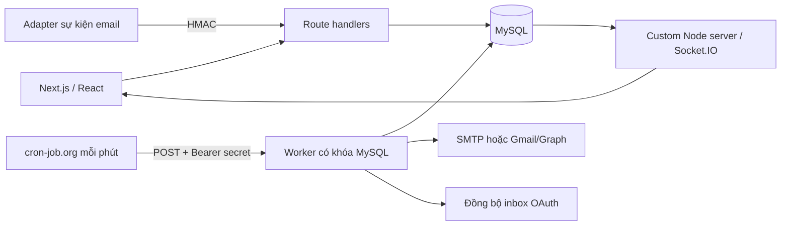

# Mailtemp · Travel Partner Workspace

Ứng dụng nội bộ cho DMC/tour operator bán dịch vụ cho đại lý và công ty lữ hành. Bản đầu dành cho hai sale, dữ liệu mới phải được rà soát trước khi gửi.

## Chạy trên máy hiện tại

Ứng dụng: **http://localhost:3000**. Tài khoản quản trị được sinh trong [LOCAL_ACCESS.md](LOCAL_ACCESS.md). Không đưa tệp đó hoặc `.env.local` lên Git.

```powershell
npm ci
npm run db:setup
npm run db:seed
npm run dev
```

MySQL phải đang chạy. `db:setup` dùng `MYSQL_ROOT_URL` để tạo database, user ứng dụng và schema. Cấu hình mặc định phù hợp Laragon local. Không khởi tạo lại thư mục dữ liệu MySQL đang có. `db:seed` là tùy chọn, tạo dữ liệu có nhãn “Mẫu”, email example.com, không tạo lượt gửi.

Nếu database/user đã được cấp sẵn, chỉnh `DATABASE_URL`, đặt `ADMIN_EMAIL` và `ADMIN_PASSWORD` rồi chạy `npm run db:migrate`. Lệnh này không cần quyền tạo database/user. Các lệnh setup/migrate không thay mật khẩu admin đã tồn tại.

### Tạo bảng và admin trên TiDB Cloud

Trong TiDB SQL Editor, tạo database trước: `CREATE DATABASE IF NOT EXISTS mailtemp CHARACTER SET utf8mb4 COLLATE utf8mb4_unicode_ci;`.

Tạo tệp riêng `.env.tidb.local` (được Git bỏ qua), sao chép **URL kết nối thật** từ TiDB > Connect vào `DATABASE_URL`. Không để nguyên chữ mẫu `USERNAME` hoặc `PASSWORD`. Username Starter cần đầy đủ tiền tố instance, dạng `<prefix>.root`. Driver tự bật TLS xác thực chứng chỉ cho hostname `*.tidbcloud.com` nếu URL chưa có tham số `ssl`.

Đặt thêm `ADMIN_EMAIL`, `ADMIN_PASSWORD` (ít nhất 12 ký tự), `MAIL_ENABLED=false` trong tệp này. Chạy bằng Node.js hỗ trợ `--env-file`:

```powershell
node --env-file=.env.tidb.local --import tsx scripts/migrate.ts
```

Chạy từ cửa sổ terminal mới, không có `DATABASE_URL`/`ADMIN_PASSWORD` cũ trong môi trường (biến môi trường hiện có được ưu tiên hơn env-file). Lệnh tạo 34 bảng, cập nhật schema và tạo admin nếu email chưa tồn tại. Không tự đổi mật khẩu tài khoản đã có. Kiểm tra trong TiDB: `SHOW TABLES FROM mailtemp;` và `SELECT email,role,active FROM mailtemp.users;`.

Trên Vercel, `DATABASE_URL` phải trỏ cùng database. Thêm biến admin trên Vercel không tự chạy migration. Migration chạy từ máy phát triển kết nối trực tiếp TiDB; không gọi gửi mail. Cấu hình `.env.local` và MySQL local có thể giữ riêng.

Chạy bản production trên máy chủ Node:

```powershell
npm run db:migrate
npm run build
npm start
```

Dùng `npm start` của dự án để khởi động **custom server kèm Socket.IO**. Không thay bằng `next start`. Giữ tiến trình Node luôn chạy bằng systemd, PM2 hoặc container.

## Các chức năng đã có

| Nhóm | Cách sử dụng |
|---|---|
| Đội ngũ | Admin tạo tài khoản sale, phân quyền theo người phụ trách đại lý, đổi mật khẩu và hủy phiên cũ |
| Dữ liệu | Import CSV/XLSX có xem trước, ánh xạ tên cột Việt/Anh thông dụng, kiểm tra email trùng, nguồn bắt buộc; export CSV theo quyền |
| Đại lý | Phân khúc, khu vực, nhóm giá, owner, pipeline, ghi chú và chuyển sale có lịch sử |
| Quyền gửi | Đánh giá riêng với pipeline; yêu cầu mục đích và chứng cứ; lịch sử đánh giá; danh sách chặn chung toàn doanh nghiệp |
| Kiểm tra email | Kiểm tra cú pháp; nút kiểm tra DNS/MX trong hồ sơ đại lý. Kết quả MX chỉ là tín hiệu kỹ thuật, không xác nhận hộp thư hoặc consent |
| Du lịch | Thư viện tour, giá net/đơn vị/tiền tệ/tier/hiệu lực/điều kiện; lưu phiên bản giá cũ khi sửa |
| Email | Mẫu thư, biến cá nhân hóa, preview chọn từng người; nháp → duyệt → lên lịch → pause/hủy; thêm nhãn `[QC]` vào tiêu đề |
| Gửi thử | Admin gửi bản thử qua SMTP tới địa chỉ đã cho phép trong `TEST_RECIPIENTS`; chưa có cấu hình thì bị chặn |
| Sequence | Một thư đầu và một follow-up tùy chọn, cách 3–30 ngày; dừng khi có reply, suppression, thay owner hoặc quyền gửi không còn hợp lệ |
| Phản hồi | OAuth Gmail/Outlook hoặc adapter sự kiện có chữ ký; phân loại thủ công, OOO trì hoãn, reply tạo việc cho sale |
| RFQ | Tuyến/ngày đi/pax/ngân sách/deadline/yêu cầu; báo giá nhiều phiên bản; ghi booking/doanh thu/lợi nhuận gộp |
| Tài liệu | PDF nội bộ tối đa 5 MB gắn với tour/RFQ, tải có xác thực và kiểm tra quyền đại lý; lưu trong MySQL để sao lưu cùng dữ liệu |
| Vận hành | Dashboard, việc cần làm, thông báo WebSocket, audit log, lịch sử cron, dừng khẩn cấp, đối soát gửi chưa xác định |
| Trợ lý AI | Góc phải dưới: tạo mẫu từ email có sẵn, viết lại/dịch, tra cứu theo quyền, gợi ý phản hồi và bản nháp công việc/RFQ/báo giá/chiến dịch; xác nhận trước khi lưu |

Import tối đa 20.000 dòng dữ liệu / 20 MB mỗi lần, hỗ trợ CSV và XLSX. Chọn tệp → chọn sheet và dòng tiêu đề → ghép các cột cần nhập vào trường hệ thống (bỏ qua cột không dùng) → kiểm tra → nhập. Hệ thống gợi ý tên cột tiếng Việt/Anh; chỉ bắt buộc email; tên công ty, nguồn và các thông tin khác có thể để trống, bổ sung sau. Hỗ trợ thêm chức danh, website, khu vực, phân khúc, thị trường, nhóm giá, ghi chú và quốc gia. Dùng `public/import-template.csv` làm mẫu. Dữ liệu được ghi theo từng nhóm 500 dòng, có tiến độ và có thể tiếp tục sau lỗi kết nối khi giữ cửa sổ nhập; nhóm đã ghi không bị nhập lại. Đóng/tải lại trang sẽ cần chọn lại tệp; email đã có được bỏ qua. Chỉ tạo thông tin đại lý mới, không ghi đè đại lý đã có; bỏ qua đại lý do sale khác phụ trách. Danh sách đại lý/liên hệ hiển thị 100 bản ghi mỗi trang. Liên hệ import luôn là `unreviewed`, hoặc `suppressed` nếu đã bị chặn. Email trên website không tự trở thành địa chỉ được phép gửi. Trạng thái pipeline “đủ điều kiện” không thay đổi quyền gửi của contact.

Trong pilot, mỗi chiến dịch chọn một contact/đại lý, cùng sale phụ trách. Hai chiến dịch đang hoạt động không được cùng giữ một đại lý. Một lượt gửi chưa rõ kết quả tiếp tục giữ quyền này kể cả khi chiến dịch đã hủy.

## Trợ lý AI DeepSeek

Bấm **Trợ lý AI** ở góc phải dưới → **Tạo mẫu từ email có sẵn** → dán thư mẫu → kiểm tra/chỉnh sửa → **Lưu vào thư viện**. Có thể trò chuyện để tra cứu dữ liệu, tóm tắt hồ sơ và chuẩn bị bước tiếp theo. Dữ liệu cần thiết được gửi đến DeepSeek; có nút tắt tra cứu hệ thống ngay trong trợ lý.

Đặt `DEEPSEEK_API_KEY`, `DEEPSEEK_MODEL=deepseek-flash`, `AI_ENABLED=true`, `AI_DAILY_REQUEST_LIMIT=60` trong `.env.local`; thay key thì khởi động lại server. Key chỉ ở máy chủ. Chạy `npm run db:migrate` khi triển khai bản cập nhật. AI tạo bản nháp; không có công cụ gửi email hoặc duyệt chiến dịch.

Nghiên cứu, kiến trúc, khả năng, giới hạn và hướng dẫn chi tiết: [docs/AI_ASSISTANT.md](docs/AI_ASSISTANT.md).

Kiểm tra: `npm run test:assistant` hoặc `npm run test:assistant:live` để gọi thêm DeepSeek thật. Cả hai không gửi email hoặc gọi cron; cần app/MySQL đang chạy, bản live cần key/số dư và dùng quota API.

## Kiến trúc



cron-job.org là bộ lập lịch HTTP; Socket.IO chạy trên máy chủ ứng dụng và cập nhật trình duyệt. Server đọc sự kiện bền vững từ MySQL mỗi giây, nên thông báo vẫn hoạt động khi API và custom server dùng các module riêng. Khi WebSocket mất kết nối, giao diện tải lại dữ liệu mỗi 30 giây.

Stack: Next.js App Router, React, TypeScript, mysql2, Socket.IO, Nodemailer, Zod, bcrypt, PapaParse và read-excel-file. MySQL/TiDB lưu hàng đợi, giao dịch và named lock; Vercel Queues kích hoạt worker trên production. Không cần Redis cho quy mô hiện tại.

## Cấu hình SMTP khi có thông tin

Thêm vào `.env.local` khi chạy local, hoặc biến môi trường máy chủ khi deploy:

```dotenv
MAIL_ENABLED=false
SMTP_HOST=smtp.example.com
SMTP_PORT=587
SMTP_SECURE=false
SMTP_USER=
SMTP_PASSWORD=
SMTP_FROM_EMAIL=sales@example.com
SMTP_FROM_NAME=Ten doanh nghiep
SMTP_REPLY_TO=
TEST_RECIPIENTS=internal@example.com
REPLY_SYNC_REQUIRED=true
```

Port 587 dùng STARTTLS, port 465 dùng `SMTP_SECURE=true`. Xác minh TLS được giữ bật. Mỗi thư chỉ có một người nhận. Nếu dùng SMTP chung, tên hiển thị là sale phụ trách; Reply-To mặc định là email đăng nhập của sale, có thể ghi đè bằng `SMTP_REPLY_TO`. Bảo đảm email đăng nhập thực sự là hộp thư công việc của sale. Nếu sale đã kết nối OAuth, worker ưu tiên gửi bằng hộp thư OAuth của sale đó.

Trong **Cài đặt → Không gian làm việc**, điền chữ ký và địa chỉ doanh nghiệp. Sau khi có credential, kiểm tra kết nối, SPF/DKIM/DMARC, gửi thử nội bộ và xác nhận đồng bộ phản hồi trước khi chuyển `MAIL_ENABLED=true`. Khởi động lại Node sau khi đổi env.

SMTP không đọc inbox. Mặc định worker giữ lượt gửi nếu chưa có đồng bộ inbox thành công trong 10 phút. Không cần tắt cơ chế này để thử giao diện hoặc import dữ liệu.

### Giới hạn gửi hiện tại

- Thứ Hai–thứ Sáu, 08:00–17:00 giờ Việt Nam; cấu hình pilot cố định.
- Mặc định 20 lượt/sale/24 giờ, tối đa cấu hình 100. Đây là giới hạn nội bộ, không phải cam kết hạn mức của Google/Microsoft.
- Cách nhau tối thiểu 60 giây/sale trong chiến dịch. Mỗi email chỉ nhận một lần cho mỗi mẫu thư; muốn lặp lại phải bật chế độ gửi lại cho lượt gửi/chiến dịch đó.
- Mỗi lượt cron xử lý tối đa **một email**, giảm rủi ro vượt thời gian HTTP. Phù hợp hai sale hiện tại.
- Không gửi khi giá hết hạn/sai tier, thiếu chứng cứ, bị chặn, approval cũ hoặc kết nối phản hồi lỗi.
- Thị trường ngoài Việt Nam được giữ lại để cấu hình policy riêng.

## Google / Microsoft OAuth

```dotenv
TOKEN_ENCRYPTION_KEY=<secret-ngau-nhien-it-nhat-32-ky-tu>
GOOGLE_CLIENT_ID=
GOOGLE_CLIENT_SECRET=
MICROSOFT_CLIENT_ID=
MICROSOFT_CLIENT_SECRET=
MICROSOFT_TENANT=common
```

Đăng ký redirect URI chính xác:

- `${APP_URL}/api/oauth/google/callback`
- `${APP_URL}/api/oauth/microsoft/callback`

Google scopes: `openid email`, `gmail.readonly`, `gmail.send`. Microsoft delegated scopes: `offline_access`, `User.Read`, `Mail.Read`, `Mail.Send`. Cấp các quyền này trong ứng dụng nhà cung cấp, cấu hình người dùng thử hoặc tenant phù hợp rồi chọn **Kết nối** ở giao diện. Việc xét duyệt ứng dụng và chấp thuận quản trị tenant phụ thuộc tài khoản thực tế.

Token được mã hóa AES-256-GCM trong database, refresh token không được trả về UI. Giữ nguyên `TOKEN_ENCRYPTION_KEY` qua các lần deploy và sao lưu riêng key này.

Đồng bộ chỉ lưu metadata/nội dung xem trước của thư từ các contact đã biết. Có khoảng chồng lặp, event idempotent; không đánh dấu sync thành công khi hết thời gian hoặc quá nhiều trang. Inbox quá lớn cần adapter với cursor/watch chuyên dụng trước khi vận hành sequence. OAuth chưa được kiểm tra với tài khoản thật vì chưa có client credentials.

## Cấu hình cron-job.org

Trước tiên deploy lên tên miền HTTPS công khai, cập nhật `APP_URL` đúng origin, không có dấu `/` cuối. Dịch vụ bên ngoài không truy cập được localhost.

Trên Vercel, đặt `APP_URL` bằng domain chính thức (ví dụ `https://mailtemp-ten.vercel.app`) và redeploy sau khi sửa Environment Variables. Ứng dụng chấp nhận chính xác các domain từ `APP_URL`, `VERCEL_PROJECT_PRODUCTION_URL`, `VERCEL_URL`, `VERCEL_BRANCH_URL` khi chạy trên Vercel; không dùng wildcard `*.vercel.app`, không tin `Host`/`X-Forwarded-Host` do client gửi. Bật **System Environment Variables** nếu muốn tự nhận domain Vercel. Khi `APP_URL` thiếu, sai định dạng hoặc vẫn trỏ localhost trên Vercel, các liên kết ứng dụng dùng domain production do Vercel cung cấp. Lỗi đăng nhập `Yêu cầu không cùng nguồn` là lỗi domain/Origin trước bước kiểm tra mật khẩu; không cần tạo lại admin hoặc database.

Trong cron-job.org tạo một job:

| Trường | Giá trị |
|---|---|
| URL | `https://mail.example.com/api/cron` |
| Method | `POST` |
| Schedule | Mỗi 1 phút |
| Header | `Authorization: Bearer <CRON_SECRET>` |
| Body | `{}` |
| Header bổ sung | `Content-Type: application/json` |

Endpoint nhận cả **GET và POST**, cùng yêu cầu `Authorization: Bearer <CRON_SECRET>` và không cache kết quả. GET hỗ trợ các scheduler mặc định GET và Vercel Cron. HEAD chỉ trả 405, không chạy worker. Trên cron-job.org nên chọn POST, bấm **Save** trước khi **Test run**; sửa header không tự đổi Request method. Không dùng `CRON_SECRET` làm tên header và không đặt secret trong URL. Production trả `queued: true` sau khi phát tác vụ; SMTP chạy trong consumer tối đa 120 giây, tách khỏi thời gian chờ 30 giây của cron-job.org. Xem trạng thái từng người nhận để biết kết quả gửi.

Secret lấy từ env máy chủ, không đặt trong URL. Bật thông báo khi job thất bại trên dịch vụ. HTTP 200 có `blocked` nghĩa là endpoint chạy được nhưng lượt gửi đang được giữ lại; xem **Lịch sử & giám sát**. HTTP 401 là sai secret. `{busy:true}` nghĩa là một lượt khác đang xử lý, không phải gửi trùng.

cron-job.org hỗ trợ POST, custom headers, lịch mỗi phút và mặc định timeout 30 giây: [FAQ chính thức](https://cron-job.org/en/faq/). Worker chiến dịch giới hạn đồng bộ khoảng 8 giây và chỉ bắt đầu tối đa một email mỗi lượt; một giao dịch SMTP có deadline 90 giây. Trên Vercel, cron chỉ xếp tác vụ còn consumer thực thi chúng. TiDB giữ tác vụ chưa bắt đầu để lần cron sau khôi phục nếu phát queue thất bại.

## Adapter sự kiện

Endpoint `POST /api/events` nhận sự kiện đã chuẩn hóa từ connector của bạn. Đây không phải webhook cắm trực tiếp cho mọi nhà cung cấp.

```json
{"eventId":"provider:unique-id","type":"reply","email":"agent@example.com","userId":"UUID-sale","subject":"Yeu cau bao gia","body":"Noi dung xem truoc","receivedAt":"2026-11-02T03:00:00Z"}
```

Các loại: `reply`, `ooo`, `delivered`, `hard_bounce`, `complaint`, `unsubscribe`, `heartbeat`. Heartbeat cần `userId` và chỉ được adapter gửi sau khi đã đọc inbox thành công. Những loại còn lại cần `email`; `delivered` cần thêm `messageId` để gắn đúng lượt gửi.

Headers:

```text
x-mailtemp-timestamp: <epoch milliseconds>
x-mailtemp-signature: <hex HMAC-SHA256(WEBHOOK_SECRET, timestamp + "." + rawBody)>
```

Chữ ký tính trên đúng chuỗi body gửi đi, sai lệch thời gian tối đa 5 phút. `eventId` duy nhất để retry không tạo reply/task trùng. Không bật `REPLY_SYNC_REQUIRED=false` để thay cho một connector hoạt động.

## Trạng thái gửi và xử lý sự cố

`pending → sending → accepted` khi nhà cung cấp chấp nhận. `deliveredAt` chỉ được ghi khi có delivery event xác thực. Accepted không chứng minh email vào inbox. Không dùng open tracking/pixel hoặc click rate làm kết quả kinh doanh.

Timeout hoặc worker gián đoạn sau claim chuyển thành `unknown`, không tự retry. Admin mở chiến dịch → **Đối soát**, tra Message-ID/log nhà cung cấp, nhập chứng cứ rồi xác nhận “đã nhận” hoặc “chưa gửi, đóng lượt này”. Không tạo follow-up tự động sau đối soát. Với Microsoft Graph, đối chiếu thêm header `x-mailtemp-message-id` vì Graph cấp internet Message-ID riêng.

Unsubscribe GET chỉ mở trang xác nhận. POST thực hiện chặn, hỗ trợ List-Unsubscribe one-click, không cần đăng nhập. Danh sách chặn không bị import/đổi sale/đánh giá lại làm mất hiệu lực.

Khi có reply đã ghi nhận, các lượt chờ của cả account được dừng. Worker kiểm tra lại ngay trước dispatch. Một email đã bắt đầu truyền tới nhà cung cấp không thể bị thu hồi chắc chắn nếu reply/pause đến đúng lúc đó; nếu kết quả chưa rõ phải đối soát.

## Deploy bằng Docker (tùy chọn)

Mẫu này chưa được chạy Docker trên máy hiện tại. Cấu hình MySQL local và production build đã được kiểm tra trực tiếp.

1. Tạo `.env.compose` với `DB_PASSWORD`, `DB_ROOT_PASSWORD` ngẫu nhiên.
2. Tạo `.env.production` từ `.env.example`; đặt `DATABASE_URL=mysql://mailtemp_app:<DB_PASSWORD-da-URL-encode>@db:3306/mailtemp`, `APP_URL` HTTPS, các secret riêng, admin thật. Giữ `MAIL_ENABLED=false`.
3. Chạy:

```sh
docker compose --env-file .env.compose up -d db
docker compose --env-file .env.compose build app
docker compose --env-file .env.compose run --rm app npm run db:migrate
docker compose --env-file .env.compose up -d app
```

4. Đặt reverse proxy theo `deploy/nginx.conf.example`; thay domain/chứng chỉ. WebSocket cần HTTP/1.1, Upgrade và Connection headers. Cổng Node chỉ bind loopback; MySQL không publish ra Internet.
5. Thử đăng nhập, thấy “Đã kết nối realtime”, thử job cron, sau đó cấu hình OAuth/SMTP. Session production dùng cookie Secure nên cần HTTPS.

Không dùng Next standalone/serverless cho custom server hiện tại. Khi tăng quy mô nhiều máy chủ, bổ sung Redis adapter/broker và tách worker trước khi tăng giới hạn gửi.

## Sao lưu và khôi phục

Sao lưu MySQL bằng `mysqldump --single-transaction --hex-blob` với file cấu hình client riêng chứa credential; không đưa mật khẩu vào câu lệnh/log. PDF nằm trong MySQL nên được backup cùng schema, consent, suppression, lịch sử giá và lượt gửi. Mã hóa bản sao lưu; lưu các secret môi trường ở nơi riêng.

Khôi phục vào database staging, chạy `db:migrate`, đặt `MAIL_ENABLED=false`, kiểm tra số account/contact/suppression/PDF và xử lý các lượt `sending` cũ thành `unknown` qua một lượt cron. Kết nối lại OAuth nếu không có key mã hóa cũ. Chỉ bật gửi sau khi đối soát các intent không chắc chắn. Restore production từ backup chưa được diễn tập trên máy này.

## Thao tác danh sách (CRUD)

Các danh sách đại lý, liên hệ, tour/bảng giá, mẫu thư, chiến dịch, công việc, RFQ, báo giá, phản hồi, thành viên và danh sách chặn có nút **Xem / Sửa / Xóa**. Thêm mới qua nút chính của từng màn hình; báo giá và PDF được quản lý trong hồ sơ RFQ, PDF chương trình nằm trong chi tiết tour. Hộp thư có **Ghi nhận phản hồi** để nhập phản hồi thủ công từ hộp thư công việc. PDF hỗ trợ tải/xem, tải lên, đổi tên và xóa.

### Xóa nhiều liên hệ trong một trang

Tại **Dữ liệu & liên hệ**, đánh dấu từng dòng hoặc ô đầu bảng để chọn toàn bộ trang hiện tại (tối đa 100 liên hệ), rồi bấm **Xóa đã chọn (N)**. Hộp thoại hiển thị danh sách và số trang trước khi xác nhận. Lựa chọn được bỏ khi chuyển trang, tìm kiếm, đổi bộ lọc hoặc chuyển màn hình; không chọn xuyên trang. Liên hệ đang có trong chiến dịch hoặc còn thư phản hồi được bỏ qua, có lý do trong kết quả. Hồ sơ đại lý và danh sách chặn được giữ nguyên. Nếu danh sách gửi lên chứa liên hệ của sale khác, toàn bộ yêu cầu bị từ chối trước khi xóa. Sau khi hoàn tất, dữ liệu tự cập nhật và bỏ chọn.

POST `/api/contacts/bulk-delete` nhận `{ "ids": ["UUID", "..."] }`, tối đa 100 ID cụ thể; trả về `{ "deleted": 0, "skipped": [], "missing": 0 }`. API yêu cầu đăng nhập/cùng Origin, kiểm tra quyền và phụ thuộc trong transaction, ghi nhật ký và phát thông báo realtime. Chỉ những ID được gửi mới được xử lý.

- Sale chỉ thao tác đại lý và hồ sơ thuộc phạm vi phụ trách. Thành viên chỉ do admin quản lý. Tour và mẫu thư là dữ liệu dùng chung như trước.
- Sửa liên hệ có thể làm chiến dịch liên quan cần duyệt lại. Đổi email, đại lý, quốc gia hoặc nguồn yêu cầu đánh giá lại quyền gửi; nếu đã có trong chiến dịch, cần tạo liên hệ mới để giữ đúng lịch sử.
- Chỉ sửa chiến dịch nháp chưa có lượt gửi. Chỉ xóa chiến dịch nháp/đã hủy chưa từng gửi. Lịch sử gửi, lượt đang xử lý hoặc cần đối soát được giữ lại.
- Xóa đại lý sử dụng xóa mềm: ẩn hồ sơ và liên hệ/công việc/RFQ/báo giá/phản hồi liên quan khỏi danh sách hoạt động, dừng các lượt email pending; giữ nguyên dữ liệu và lịch sử để đối soát. Có thể xóa khi còn dữ liệu liên quan; chỉ cần đợi nếu có email đang gửi. Đại lý đã xóa không được chọn cho chiến dịch hoặc tiếp tục gửi. Email đã tồn tại trong hồ sơ đã xóa vẫn được coi là trùng khi nhập, không tự khôi phục hồ sơ hoặc quyền gửi. Liên hệ còn thư phản hồi hoặc nằm trong chiến dịch, RFQ còn báo giá, tour/mẫu còn được chiến dịch sử dụng sẽ bị từ chối xóa với thông báo rõ ràng. Xóa tour/RFQ cũng xóa PDF thuộc hồ sơ đó.
- Sửa/xóa báo giá được ghi nhật ký; số phiên bản mới tiếp tục tăng, không dùng lại số của phiên bản đã xóa.
- Thành viên có lịch sử hoặc hồ sơ liên quan cần chuyển người phụ trách và chọn **Ngừng hoạt động**. Đổi vai trò, email, mật khẩu hoặc ngừng hoạt động thu hồi phiên đăng nhập. Không tự xóa/hạ quyền/ngừng hoạt động tài khoản admin đang đăng nhập; luôn giữ admin hoạt động.
- Chỉ admin được gỡ chặn thủ công, cần căn cứ ít nhất 20 ký tự. Liên hệ quay về **Chưa đánh giá**, các lượt đã bỏ qua không tự gửi lại. Từ chối nhận tin, hard bounce, khiếu nại được giữ nguyên; xóa liên hệ không xóa địa chỉ đã chặn.
- Nhật ký kiểm toán, thông báo và lịch sử xử lý do hệ thống tạo; các lịch sử này chỉ cho phép xem để đối soát. Thông báo vẫn hỗ trợ đánh dấu đã đọc.

GET `/api/{resource}` và `/api/{resource}/{id}` đọc danh sách/chi tiết theo quyền. DELETE theo ID kiểm tra phụ thuộc trong transaction. Sửa thông tin đầy đủ của accounts/contacts/campaigns/tasks/rfqs/messages dùng PATCH `/api/{resource}/{id}/details`; các endpoint PATCH đánh giá consent, trạng thái chiến dịch/công việc/phản hồi cũ vẫn được giữ. Các tài nguyên còn lại dùng PATCH theo ID. Gỡ chặn thủ công gửi `{ "evidence": "căn cứ và lý do" }` trong DELETE. Mọi mutation yêu cầu phiên đăng nhập và cùng Origin.

**Chương trình / bảng giá là tùy chọn trong chiến dịch.** Có thể chọn “Không chọn chương trình / bảng giá” khi tạo/sửa, kể cả khi chưa có tour nào. API nhận `productId` bị bỏ qua, `null` hoặc chuỗi rỗng và lưu thành `NULL`. Chiến dịch không gắn chương trình vẫn dùng mẫu thư, cá nhân hóa người nhận, kiểm tra quyền gửi và dừng follow-up khi có phản hồi. Nếu subject/body/follow-up dùng biến `tour_name`, `duration`, `price`, `unit`, `valid_until` hoặc `conditions`, cần chọn chương trình hoặc sửa mẫu trước khi duyệt. Chạy `npm run db:migrate` để cập nhật database hiện có; không xóa dữ liệu cũ.

## Kiểm thử

```powershell
npm test
npm run test:crud
npm run test:bulk-delete
npm run test:account-delete
npm run test:optional-product
npm run test:import
npm run test:integration
npm run typecheck
npm run lint
npm run build
npm audit --omit=dev
```

`test:crud` cần app/MySQL đang chạy, kiểm tra vòng đời dữ liệu của 11 nhóm danh sách và PDF, quyền sale/admin, phụ thuộc, quyền gửi, thu hồi session và giữ lịch sử gửi. Tạo dữ liệu UUID riêng và dọn sau khi chạy; không gọi cron, SMTP hoặc duyệt chiến dịch. Chạy trên database phát triển.

`test:bulk-delete` kiểm tra giới hạn 100 liên hệ, quyền sale, xóa một phần khi có phụ thuộc, giữ dữ liệu ngoài lựa chọn, giữ danh sách chặn, gửi lại yêu cầu và xóa đồng thời. Tự tạo/dọn dữ liệu thử, không gọi SMTP hoặc cron.

`test:account-delete` kiểm tra xóa đại lý có liên hệ, công việc, RFQ/báo giá và lịch sử gửi; dừng pending, giữ accepted/unknown và người nhận khác; quyền sale/admin, danh sách/CSV/trợ lý AI, nhập lại và xóa đồng thời. Tự tạo/dọn fixture, không gọi gửi thư, cron, duyệt hoặc lên lịch chiến dịch. Sau khi cập nhật mã nguồn, chạy `npm run db:migrate` để thêm cột `accounts.deletedAt` trên database hiện có (có thể chạy lại).

`test:optional-product` kiểm tra tạo/sửa/danh sách/xem trước/duyệt chiến dịch không gắn bảng giá, biến chương trình trong thư và follow-up, cùng hai bước claim/kiểm tra trước gửi của worker. Chỉ dùng fixture riêng; các lượt worker thử có hạn gửi ở năm 2099, không gọi cron, SMTP/OAuth gửi thư hoặc API lên lịch. Tự dọn fixture sau khi chạy.

`test:import` cần app/MySQL đang chạy, kiểm tra riêng luồng nhập 20.000 liên hệ, ghép cột, giới hạn số dòng, tiếp tục phiên nhập và chống ghi trùng; tự dọn dữ liệu thử, không gọi cron hoặc SMTP. Chạy trên database phát triển.

Integration cần app/MySQL đang chạy và `MAIL_ENABLED=false`. Script tạo fixture UUID riêng rồi dọn dữ liệu fixture; có thể có audit/thông báo hệ thống phát sinh từ các ca kiểm thử. Không chạy kiểm thử này trên database production. Các ca bao gồm quyền sale/CSRF, import chưa cấp quyền gửi, duyệt cạnh tranh, thay giá/mẫu, cron khóa chống chồng, tắt gửi, webhook idempotent, dừng follow-up, unknown không retry, unsubscribe, tài liệu private và WebSocket.

## Phần cần cấu hình hoặc mở rộng tiếp

- SMTP thật, OAuth client và mailbox thật; kiểm tra gửi/nhận, bounce, provider quota, SPF/DKIM/DMARC trước pilot.
- Tên miền, TLS, cron-job.org job và giám sát máy chủ thật.
- PDF hiện là tài liệu nội bộ; chưa tự đính kèm vào email hoặc tạo portal/link công khai cho đối tác.
- Trợ lý AI đã có soạn/tra cứu và lưu bản nháp. Chưa có AI đọc PDF/duyệt web/stream token, A/B test, ESP broadcast, CRM/calendar, báo giá tự tính hoặc thiết kế email kéo thả.
- Soft bounce không tự retry; cần adapter phân loại và quy tắc retry riêng. DNS/MX là thao tác kiểm tra theo yêu cầu.
- Lịch gửi hiện cố định; chưa có lịch nghỉ lễ, giờ riêng từng sale hoặc policy thị trường nước ngoài.
- Báo cáo hiện là số liệu vận hành/pipeline; chưa có phân tích cohort/attribution doanh thu nhiều chiến dịch. Tour/RFQ dùng trường điều kiện/ghi chú cho cấu trúc giá và tiêu chuẩn dịch vụ chi tiết.
- Danh sách tải theo workspace phù hợp quy mô nhỏ; cần phân trang phía server, index bổ sung và cursor inbox khi tăng lớn.

Plan nghiệp vụ gốc: [PLAN_TOOL_EMAIL_B2B_DU_LICH.md](PLAN_TOOL_EMAIL_B2B_DU_LICH.md).

Nhập chỉ có email: ghép cột Email liên hệ rồi xem trước và nhập; không cần cột công ty hoặc nguồn chung. Các trường trống được giữ trống. Mỗi email chưa có tên công ty có hồ sơ đại lý trống riêng để bổ sung sau; không gộp các email chưa xác định công ty. Liên hệ mới vẫn chưa đánh giá quyền gửi; thông tin thiếu cần được hoàn thiện trước khi xét quyền gửi.

## Điều kiện nhận tin theo chiến dịch

- `recipientPolicy=eligible_only` (mặc định, kể cả chiến dịch cũ): yêu cầu liên hệ eligible có mục đích và chứng cứ nhận tin.
- `recipientPolicy=include_unreviewed`: cho phép thêm trạng thái unreviewed; không sửa consent hoặc tạo chứng cứ cho liên hệ. needs_evidence/ineligible/suppressed vẫn bị loại. Các điều kiện nguồn dữ liệu, quốc gia VN, bảng giá, tần suất, quyền sở hữu và đại lý đã xóa vẫn áp dụng.
- Tạo/sửa bản nháp hoặc chọn Điều kiện nhận tin ở màn hình vận hành chiến dịch. Đổi bộ lọc hủy duyệt cũ; chỉ cho đổi khi chiến dịch chưa có lượt xử lý.
- Kiểm tra người nhận có ba nhóm Tất cả / Đạt / Không đạt, tìm kiếm, phân trang 50 dòng và xuất CSV theo nhóm/tìm kiếm.
- Khi có người không đạt, người gửi xác nhận chỉ duyệt phần đạt. API approve nhận `previewToken` từ GET chi tiết và `acceptExclusions:true`; token cũ sẽ bị từ chối nếu danh sách/nội dung đã thay đổi. Không có người đạt thì không thể duyệt. Những lượt không đạt được lưu skipped kèm lý do. Lên lịch chỉ lấy pending; worker kiểm tra lại policy khi claim và trước dispatch.
- Dữ liệu mới chưa đánh giá không đồng nghĩa đã đồng ý nhận quảng cáo. Người gửi cần xác định quyền gửi phù hợp; lựa chọn bộ lọc là cấu hình nghiệp vụ, không xác nhận sự đồng ý.
- Cập nhật CSDL: `npm run db:migrate` (idempotent). Kiểm thử fixture API và hai bước worker: `npm run test:recipient-policy`; không chạy cron, không gọi transport, không gửi email thật.

## Gửi mail trực tiếp

Menu **Gửi mail trực tiếp** (`/?view=direct-mail`) cho phép tự soạn hoặc lấy nội dung từ mẫu, chọn chương trình tùy chọn, chọn tối đa 1.000 liên hệ, kiểm tra từng người nhận và xác nhận **Gửi ngay**. Mặc định bộ lọc bao gồm liên hệ chưa đánh giá; người gửi có thể chọn chỉ liên hệ đủ điều kiện. Các kiểm tra chặn, nguồn, quốc gia VN, bảng giá, quyền sở hữu và kiểm tra mẫu đã gửi vẫn áp dụng. Hệ thống báo rõ xung đột với lượt gửi/chiến dịch đang hoạt động; hủy lượt chờ cũ trước khi tạo lượt mới để tránh gửi trùng.

- Trên Vercel production, API lưu lượt gửi vào TiDB rồi phát tác vụ Vercel Queues. Consumer riêng xử lý một người nhận mỗi lần, phát tác vụ tiếp theo nếu còn người chờ. `vercel.json` đăng ký consumer private; SDK dùng OIDC tự động, không cần thêm khóa dịch vụ. TiDB và named lock quyết định quyền gửi, kể cả khi queue giao cùng tác vụ nhiều lần. Local/VPS vẫn dùng `server.ts` kiểm tra hàng đợi mỗi giây.
- Cần MySQL/TiDB, SMTP hoặc OAuth và `MAIL_ENABLED=true`. Gửi trực tiếp không chờ giờ hành chính, không yêu cầu địa chỉ doanh nghiệp hay đồng bộ inbox và không áp dụng giới hạn pilot của chiến dịch. Giới hạn nhà cung cấp và dừng khẩn cấp vẫn áp dụng. Đóng trình duyệt không dừng gửi. Preview không phát tác vụ queue; dùng production để kiểm tra queue thực tế.
- `direct_mail_batches` và `direct_mail_recipients` lưu nội dung, bộ lọc, snapshot bảng giá, kết quả từng email, số lần thử và Message-ID. Khóa idempotency theo người gửi + requestId ngăn bấm lặp hoặc mất phản hồi tạo nhiều lượt. Nội dung và danh sách được kiểm tra bằng token trước xác nhận; kiểm tra lại quyền/chặn/địa chỉ ngay trước dispatch.
- Trạng thái `accepted` chỉ xác nhận nhà cung cấp nhận yêu cầu, chưa xác nhận vào Inbox. SMTP 4xx/5xx hoặc lỗi trước DATA hiển thị `failed` với giai đoạn và mã lỗi; lỗi mất kết nối sau khi bắt đầu DATA là `unknown`, không tự gửi lại. Hệ thống theo dõi tiến trình SMTP vì lỗi Nodemailer `command=CONN` vẫn có thể xảy ra sau DATA. Quản trị viên có thể đối soát theo Message-ID và nhập bằng chứng. Tạm dừng/tiếp tục hoặc dừng phần chưa gửi; email đã chuyển tới nhà cung cấp không thể thu hồi.
- SMTP: kết nối 30 giây, chào 30 giây, socket 60 giây, tổng tối đa 90 giây và đóng socket thật khi hết hạn. Function consumer tối đa 120 giây, claim gián đoạn sau 5 phút chuyển `unknown`, không tự gửi lại. Trên Vercel, cron chỉ phát tác vụ khôi phục và tác vụ chiến dịch rồi trả kết quả, không chờ SMTP. `queued: true` nghĩa là đã xếp tác vụ, không có nghĩa đã gửi mail. Có thể giữ job cron-job.org mỗi phút và header Bearer hiện tại.
- Settings hiển thị lần chạy worker, số email chờ, tuổi lượt chờ, lần khôi phục và lỗi queue. Nút kiểm tra SMTP gọi `verify()` (kết nối/xác thực, không gửi thư), ghi thời điểm và kết quả gần nhất. Kết quả đó không xác nhận vào Inbox.
- Nội dung thư không tự thêm chữ ký, địa chỉ hoặc liên kết từ chối; hãy soạn chữ ký trực tiếp trong mẫu nếu cần. Header kỹ thuật List-Unsubscribe vẫn được giữ. Bỏ bắt buộc địa chỉ doanh nghiệp trong tính năng này là cấu hình nghiệp vụ; không xác nhận quyền gửi quảng cáo của danh sách.
- API: `POST /api/direct-mail/preview`, `POST /api/direct-mail` với `{input,requestId,previewToken,acceptExclusions}`, `GET /api/direct-mail`, `GET /api/direct-mail/:id`, `PATCH /api/direct-mail/:id` với action pause/resume/cancel; `POST /api/direct-mail/:id/reconcile` chỉ admin. Phiên đăng nhập và cùng Origin áp dụng cho mọi thao tác.
- Chạy `npm run db:migrate` trước khi khởi động bản mới. Kiểm thử `npm run test:direct-mail` khóa hàng đợi nền trong toàn bộ vòng đời fixture và dùng bộ gửi giả được inject trong tiến trình; không gọi cron, SMTP hoặc OAuth thật. Không có API cho phép client chọn bộ gửi giả.
- Bản sửa queue không cần thêm bảng/cột. `npm test` kiểm tra điều phối queue, lỗi tải giao diện và SMTP giả lập. `npm run test:direct-queue` kiểm tra DB thật với transport inject: khóa đồng thời, mỗi lần một người nhận, lặp tác vụ không gửi lại, claim gián đoạn, pause/resume/cancel. Chạy fixture trên database phát triển.


## Xung đột người nhận và gửi lại có kiểm soát

- Gửi trực tiếp khóa theo email đã chuẩn hóa, gồm địa chỉ snapshot của lượt cũ. Một email khác cùng đại lý không bị giữ theo email đang chờ/đang gửi/chưa xác định. Kiểm tra được áp dụng ở xem trước, xác nhận và worker; kiểm tra trực tiếp với chiến dịch cũng dùng email. Quy tắc giữa hai chiến dịch vẫn giữ phạm vi đại lý.
- Danh sách kiểm tra hiển thị tên lượt, email gây chặn, trạng thái và nút **Xem lượt đang chặn**. Hủy phần chờ hoặc đối soát sẽ cập nhật lại danh sách xem trước. Sale không được xem danh tính lượt của sale khác.
- Quản trị viên có thể **Cho phép gửi lại một lần** cho một lượt `unknown`, nhập lý do tối thiểu 20 ký tự và xác nhận nguy cơ nhận trùng. Lượt cũ vẫn giữ `unknown`, Message-ID và nội dung lỗi; không tự ghi thành chưa gửi. Batch cũ chuyển `review_released` khi mọi lượt chưa xác định đã được mở khóa.
- Quyền được lưu ở `retryAuthorizedAt`, `retryAuthorizedBy`, `retryReason`; khi tạo một lượt thay thế, `retryConsumedBy` trỏ đến người nhận mới. Người gửi phải xác nhận nguy cơ trùng lần nữa. Cập nhật quyền và tạo lượt mới nằm trong cùng transaction, không cho hai yêu cầu dùng cùng quyền. RequestId tiếp tục chống bấm lặp. Không tự gửi lại và không cho worker chiến dịch dùng quyền này.
- Nếu lượt thay thế lại có kết quả `unknown`, nó tiếp tục chặn email đó và cần xử lý mới. Trạng thái accepted được kiểm tra theo mẫu thư đã gửi; việc mở khóa không bỏ qua danh sách chặn, quyền sale, email thay đổi hoặc các điều kiện nhận tin.
- Cập nhật database: `npm run db:migrate` (có thể chạy lại). Kiểm thử: `npm run test:direct-conflicts` dùng fixture, khóa hàng đợi thật, kiểm tra phạm vi email, metadata/quyền truy cập, mở khóa một lần, gửi đồng thời, lịch sử snapshot, xác nhận gửi và worker chiến dịch; không gọi SMTP/OAuth/cron.

## Kiểm tra mẫu thư đã gửi

- Thay giới hạn chờ 24 giờ của từng liên hệ bằng lịch sử **email + mẫu thư**, dùng chung cho gửi trực tiếp và chiến dịch, không hết hạn theo thời gian. Mẫu khác có thể gửi ngay khi đạt các điều kiện còn lại.
- Mẫu được chọn từ danh sách nhận diện theo ID, kể cả sau khi sửa nội dung. Thư tự soạn nhận diện theo tiêu đề/nội dung đã chuẩn hóa xuống dòng và khoảng trắng đầu/cuối. Follow-up có nội dung riêng được kiểm tra riêng; nội dung trùng vẫn bị chặn.
- **Cho phép gửi lại mẫu đã gửi** mặc định tắt, chỉ áp dụng cho lượt gửi hoặc chiến dịch đang soạn. Gửi trực tiếp tự tắt tùy chọn sau khi lưu lượt. Đổi chế độ của chiến dịch yêu cầu duyệt lại và chỉ thực hiện trước khi có lần xử lý đầu tiên.
- Chế độ gửi lại bỏ chặn lịch sử `accepted`, vẫn giữ danh sách chặn, điều kiện nhận tin, chống bấm lặp và đối soát `unknown`. Lịch sử gửi cũ được backfill bởi `npm run db:migrate`; không xóa hoặc đặt lại số lần gửi.
- Kiểm thử: `npm test`, `npm run test:template-history` (app và MySQL local; fixture có khóa queue và transport inject, không gửi email thật).


## Kết nối Webmail (IMAP)

- Vào **Cài đặt → Kết nối & gửi email → Kết nối Webmail**. Nhập email, hostname IMAP, username và mật khẩu webmail. Hiện hỗ trợ IMAP SSL/TLS cổng 993 với chứng chỉ hợp lệ; lấy thông số từ **Configure Mail Client → Secure SSL/TLS Settings** của hosting.
- Nút **Kiểm tra & kết nối** xác thực và mở INBOX ở chế độ chỉ đọc trước khi lưu. Mật khẩu mã hóa AES-256-GCM bằng `TOKEN_ENCRYPTION_KEY`; không đưa vào state/API trả về. Không đổi khóa mã hóa đang sử dụng nếu chưa kết nối lại các hộp thư.
- Bấm **Đồng bộ ngay** để lấy phản hồi. Cron hiện có tiếp tục đồng bộ tự động. Lần đầu xét thư trong 7 ngày gần nhất; chỉ ghi nhận người gửi thuộc liên hệ của sale đang kết nối, không lấy thư gửi bởi chính hộp thư. Không thay đổi trạng thái đã đọc hoặc xóa thư trên máy chủ.
- UID/UIDVALIDITY lưu tiến trình; Message-ID chống nhập trùng khi chạy lại. Mỗi lượt tối đa 200 thư, đọc tối đa 256 KiB/thư. Khi hết thời gian hoặc còn thư, lượt sau tiếp tục từ UID cuối; chưa báo đồng bộ hoàn tất để tránh gửi follow-up khi chưa kiểm tra hết phản hồi. Email phản hồi dừng follow-up và tạo công việc; thư tự động được xử lý riêng.
- Webmail chỉ bổ sung nhận thư IMAP. Gửi vẫn dùng SMTP cấu hình trên máy chủ; `MAIL_ENABLED=true` và SMTP hợp lệ vẫn bắt buộc. Nếu không đặt `SMTP_REPLY_TO`, địa chỉ Webmail kết nối được dùng làm Reply-To. Cần cấu hình SMTP và hộp thư nhận phù hợp để khách trả lời đúng địa chỉ.
- Mỗi người dùng kết nối một hộp thư. Muốn đổi tài khoản/nhà cung cấp, ngắt kết nối rồi kết nối lại. Ngắt kết nối xóa cả mật khẩu mã hóa và cursor, giữ lịch sử phản hồi đã ghi nhận.
- Chạy `npm run db:migrate` trước bản mới để tạo bảng `webmail_connections` trên MySQL/TiDB. Không cần thêm biến môi trường IMAP hay OAuth client cho Webmail.
- Kiểm thử: `npm test` và `npm run test:webmail` (database local, phiên IMAP giả lập trong tiến trình, không gửi email thật).

Build dùng `next build --webpack` để tránh lỗi junction của Turbopack trên Windows với thư viện IMAP. Đây là tùy chọn chính thức của Next.js: https://nextjs.org/docs/app/guides/upgrading/version-16.
