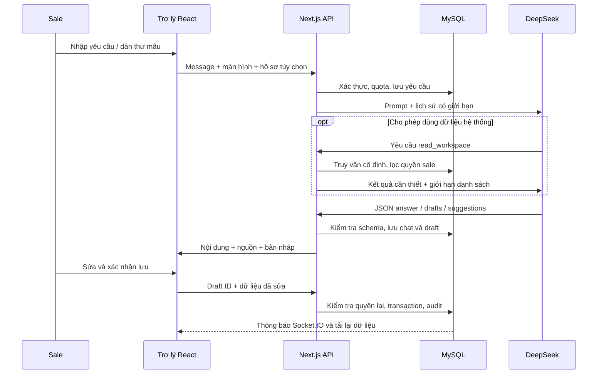

# Trợ lý AI Mailtemp

## Mục tiêu và lựa chọn thiết kế

Trợ lý phục vụ hai sale DMC/tour operator trong chính màn hình đang làm việc. Công việc thường gặp là chuyển email có sẵn thành mẫu tái sử dụng, chuẩn bị phản hồi, tra cứu đại lý và theo sát RFQ. Vì dữ liệu chủ yếu là khách mới từ website, việc soạn nội dung và việc cho phép gửi cần có các bước xác nhận riêng.

Nghiên cứu tích hợp dựa trên tài liệu chính thức DeepSeek:

- [API và xác thực](https://api-docs.deepseek.com/): gọi Chat Completions từ máy chủ bằng Bearer key.
- [Function calling](https://api-docs.deepseek.com/guides/tool_calls/): model yêu cầu công cụ; ứng dụng quyết định công cụ và dữ liệu được trả về.
- [JSON output](https://api-docs.deepseek.com/guides/json_mode/): yêu cầu JSON và cung cấp cấu trúc ví dụ; ứng dụng vẫn phải kiểm tra kết quả bằng schema.
- [Danh sách model](https://api-docs.deepseek.com/api/list-models/): kiểm tra model thực tế của tài khoản trước khi cấu hình.

Tài khoản thử nghiệm đã trả về `deepseek-flash` và `deepseek-v4-pro` trong lần kiểm tra ngày 02/11/2026. Bản này sử dụng `deepseek-flash`; lựa chọn này đã được kiểm chứng bằng các yêu cầu thật, chưa phải kết luận benchmark chất lượng hoặc chi phí giữa các model. Model có thể đổi bằng biến môi trường.

Với quy mô hiện tại, công cụ truy vấn MySQL theo cấu trúc cố định đáp ứng nhu cầu tra cứu, phân quyền và dẫn nguồn. Chưa cần vector database hoặc framework agent. Không thêm dependency cho SDK AI: sử dụng `fetch` có sẵn của Node.

## Những việc đã hỗ trợ

| Công việc | Cách thực hiện và kết quả |
|---|---|
| Email mẫu → mẫu tái sử dụng | Dán thư, chọn văn phong/ngôn ngữ; AI trả tên mẫu, nhóm, tiêu đề, nội dung và biến cá nhân hóa; sửa/xem trước rồi lưu thư viện |
| Viết lại, dịch, rút gọn | Yêu cầu trong chat; có thể yêu cầu bản nháp template hoặc reply |
| Trả lời và follow-up | Dùng nội dung dán hoặc chọn phản hồi; tạo nội dung để sao chép sang hộp thư |
| Tra cứu dữ liệu | Đại lý, liên hệ, tour/bảng giá, mẫu thư, chiến dịch, phản hồi, công việc, RFQ và báo giá theo quyền |
| Ưu tiên công việc | Đọc thống kê và danh sách liên quan, đề xuất bước tiếp theo; không suy tổng từ danh sách bị cắt |
| Chuẩn bị bản ghi | Tạo bản nháp công việc, RFQ, phiên bản báo giá hoặc chiến dịch; người dùng xem và xác nhận trước khi ghi |
| Hướng dẫn vận hành | Giải thích consent, trạng thái gửi, kết nối inbox/SMTP, cron, WebSocket và quy trình hệ thống |
| Tiếp nối công việc | Lịch sử riêng từng tài khoản; chọn lại cuộc trò chuyện; nguồn dữ liệu có liên kết mở hồ sơ |

AI không có công cụ gửi mail, duyệt/lên lịch chiến dịch, sửa quyền nhận tin, bỏ chặn, đổi cấu hình hoặc chạy SQL tùy ý. Chiến dịch được lưu ở trạng thái nháp. Bản reply chỉ có chức năng sao chép.

## Cách dùng

1. Đăng nhập, bấm **Trợ lý AI** ở góc phải dưới; trợ lý có mặt trên mọi màn hình của workspace.
2. Chọn gợi ý **Tạo mẫu từ email có sẵn** trong cuộc trò chuyện mới, dán nội dung mẫu, chọn văn phong và ngôn ngữ. Tắt **Dùng dữ liệu hệ thống** nếu yêu cầu chỉ cần nội dung vừa dán.
3. Bấm nút mũi tên hoặc Enter. Shift+Enter để xuống dòng.
4. Kiểm tra thẻ **Mẫu email**, bấm **Chỉnh sửa** để sửa tên, nhóm, tiêu đề và nội dung; bấm **Xem trước** để đọc lại.
5. Bấm **Lưu vào thư viện**. Mẫu xuất hiện ở **Thư viện mẫu thư** và có thể dùng trong quy trình chiến dịch hiện có.

Trong hồ sơ đại lý, tour, RFQ, phản hồi hoặc chi tiết chiến dịch, bấm **Nhờ trợ lý…** để gắn đúng hồ sơ. Có thể đổi hồ sơ ở ô chọn của trợ lý hoặc chọn **Không gắn hồ sơ cụ thể**.

Ví dụ yêu cầu:

- “Chuyển thư mẫu này thành email giới thiệu tour cho đại lý, dùng biến giá và điều kiện.”
- “Viết lại bản nháp trên bằng tiếng Anh, ngắn gọn và lịch sự.”
- “Tìm đại lý ABC, tóm tắt tình hình và đề xuất bước tiếp theo.”
- “Đọc phản hồi đang chọn và soạn trả lời, hỏi thêm ngày đi và số khách.”
- “Tạo công việc gọi đại lý đang chọn lúc 10 giờ ngày 05/11/2026, ưu tiên cao.”
- “Tại sao SMTP có cấu hình nhưng chưa gửi được? Kiểm tra trạng thái vận hành.”

Biến hỗ trợ: `contact_name`, `company_name`, `sender_name`, `tour_name`, `duration`, `price`, `unit`, `valid_until`, `conditions`, với cú pháp `{{ten_bien}}`. `company_name` là tên **đại lý nhận thư**, `sender_name` là tên sale gửi. Giá và điều kiện cần được đối chiếu bảng giá; AI không xác nhận tính đúng của cam kết thương mại.

## Kiến trúc và luồng dữ liệu



- `GET/POST /api/assistant`: cấu hình công khai không có key, quota, lịch sử và xử lý chat.
- `POST /api/assistant/actions`: áp dụng draft thuộc người dùng khi `confirmed=true`.
- `ai_threads`, `ai_messages`: lịch sử riêng của chủ cuộc trò chuyện; admin khác cũng không đọc được qua API.
- `ai_requests`: trạng thái, idempotency, quota, model và số token.
- `ai_drafts`: payload, loại, trạng thái chờ/đã áp dụng, ID bản ghi đã tạo.
- `read_workspace`: duy nhất công cụ phía model; query có tham số và allowlist tài nguyên; tối đa 15 bản ghi/lượt.

Model không nhận session/token OAuth/password SMTP/API key. Key DeepSeek chỉ được dùng trong Authorization của request máy chủ đến DeepSeek. Nội dung người dùng dán có chuỗi key hoặc khai báo password/secret được che theo mẫu; đây không phải bộ lọc mọi loại dữ liệu cá nhân.

## Quyền, giới hạn và độ tin cậy

- Sale đọc đại lý mình phụ trách và công việc của mình; tour/mẫu là tài nguyên dùng chung. Admin đọc phạm vi nghiệp vụ toàn doanh nghiệp. Trạng thái mailbox chỉ lấy của tài khoản đang đăng nhập.
- Dữ liệu chat và phần hồ sơ cần thiết sẽ được gửi đến DeepSeek, có thông báo ngay trong giao diện. Tắt dữ liệu hệ thống ngăn tra cứu mới; **lịch sử chat trước đó vẫn được dùng**. Mở cuộc trò chuyện mới nếu cần tách ngữ cảnh cũ.
- Email mẫu/ghi chú/kết quả tool được xem là dữ liệu không đáng tin. Prompt yêu cầu bỏ qua chỉ dẫn chèn trong đó; quyền đọc/ghi còn được chặn độc lập bằng API và SQL.
- Server giữ lịch sử; client không truyền system prompt hay tự thay lịch sử. Model dùng tối đa 10 tin gần nhất, UI tải tối đa 60 tin/cuộc và danh sách 20 cuộc gần nhất.
- Mặc định 60 yêu cầu/người/24 giờ, tối đa 6 yêu cầu/phút và một yêu cầu đang xử lý/người. Quota tính cả yêu cầu thất bại đã nhận; không tính lượt lưu draft.
- Tối đa 4 lượt model, 3 tool call/lượt, 4.200 token đầu ra/lượt, tổng timeout provider 70 giây. Vòng cuối không cấp tool. Phản hồi rỗng/sai schema/bị cắt sẽ báo lỗi và không áp dụng draft.
- UUID yêu cầu chống chạy lại request đã hoàn thành; khóa draft và transaction chống lưu trùng. Quyền hồ sơ được kiểm tra lại khi xác nhận.
- Lưu draft có timeout 15 giây/lượt và thử lại một lần khi lỗi mạng hoặc mất phản hồi, dùng nguyên draft ID/payload. Nếu lần đầu đã ghi xong, server trả lại bản ghi đó. Lỗi đăng nhập/quyền/dữ liệu không tự retry. Khi vẫn mất kết nối, UI giữ bản nháp, giải thích chưa xác nhận được kết quả và cho bấm lưu lại.
- Audit chỉ ghi metadata thao tác/số token, không ghi toàn bộ chat. Chat vẫn lưu trong MySQL và đi cùng bản sao lưu. Chưa có giao diện xóa hội thoại hoặc chính sách tự động dọn lịch sử; cần bổ sung khi đưa vào quy trình lưu trữ dữ liệu của doanh nghiệp.
- AI có thể viết sai hoặc hiểu nhầm yêu cầu. Người dùng cần kiểm tra tên bên gửi/nhận, giá, thời hạn, điều kiện và bản ghi đích trước khi xác nhận. Kiểm tra consent/approval trước gửi vẫn do quy trình hiện tại thực hiện.

## Cấu hình và vận hành

Thêm vào `.env.local` (không đưa key lên Git):

```dotenv
AI_ENABLED=true
DEEPSEEK_API_KEY=<key-tren-may-chu>
DEEPSEEK_MODEL=deepseek-flash
AI_DAILY_REQUEST_LIMIT=60
```

Máy chủ đã được cấu hình với key thử do người dùng cung cấp. Khi đổi key, cập nhật `.env.local` rồi khởi động lại tiến trình Node. Key không có tiền tố `NEXT_PUBLIC_`. `AI_ENABLED=false` tắt các yêu cầu model. Hạn mức hợp lệ 1–300/người/24 giờ.

Triển khai schema bằng `npm run db:migrate`, build bằng `npm run build`, khởi động custom server bằng `npm start`. Reverse proxy cần cho request chat chạy đủ thời gian. AI gọi DeepSeek trực tiếp từ Next.js server, không phụ thuộc cron-job.org. Socket.IO cập nhật thông báo sau lưu; bản này trả chat sau khi xử lý xong, chưa stream từng token.

Thông báo lỗi phân biệt key không hợp lệ, hết số dư, quá hạn mức, timeout và model không hỗ trợ. Không hiển thị raw error provider có khả năng chứa dữ liệu nhạy cảm.

## Kiểm thử đã thực hiện

- `npm test`: biến template, giới hạn input, đầu ra JSON không hợp lệ, từ chối loại hành động AI không hỗ trợ cùng các kiểm tra policy gửi hiện có.
- `npm run test:assistant`: xác thực, CSRF, quyền riêng lịch sử, phạm vi sale, không lộ secret cấu hình, xác nhận draft, lưu một lần, cache request, quyền task, campaign luôn nháp và quota.
- `npm run test:assistant:live`: thêm yêu cầu DeepSeek thật cho email mẫu → draft → sửa → lưu; selected context; function calling tìm đại lý theo quyền. Script tạo rồi dọn fixture, không gửi email hoặc gọi cron. Yêu cầu có chi phí API theo tài khoản.
- Kiểm tra trình duyệt: mở trợ lý, nhập mẫu thật qua UI, sửa/lưu, thấy mẫu trong thư viện, khôi phục lịch sử và bố cục desktop/mobile.

Không chạy `test:integration` hiện có trong khi `MAIL_ENABLED=true`; bộ đó kiểm tra worker/cron và yêu cầu cấu hình riêng.

## Hướng mở rộng ưu tiên

1. Pilot hai sale: đo tỷ lệ draft được dùng, số lần sửa và token; dùng tập tình huống thực tế đã loại dữ liệu nhạy cảm để đánh giá chất lượng.
2. Thêm chính sách lưu/xóa lịch sử, quota chi phí và dashboard sử dụng cho admin.
3. Stream phản hồi, hủy request, retry có cùng request ID, tìm kiếm lịch sử cũ.
4. Đọc PDF tour/RFQ theo quyền, trích xuất có nguồn trang; hiện chưa đọc file đính kèm hoặc duyệt web.
5. Tra cứu ngữ nghĩa khi kho tài liệu đủ lớn; chỉ bổ sung vector index khi tìm kiếm hiện tại không đáp ứng.
6. Phân loại phản hồi và gợi ý RFQ tự động ở chế độ người dùng duyệt, đo độ chính xác trước khi tự động hóa thêm.
